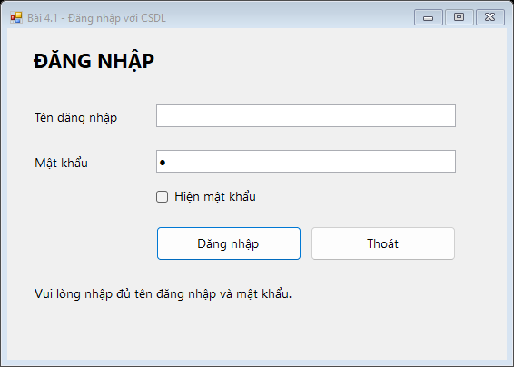
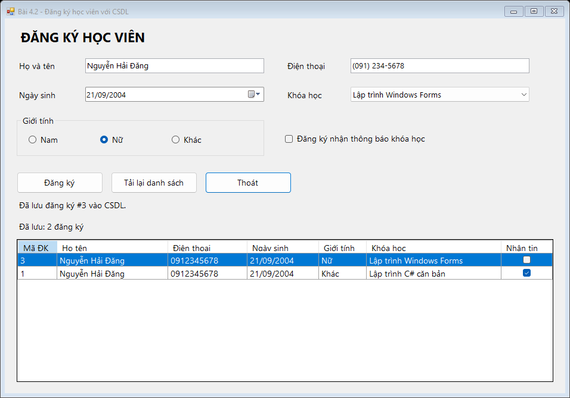

# Bài tập 4.1 và 4.2 - Nâng cấp lưu trữ CSDL

- Sinh viên: **Nguyễn Hải Đăng - 24810320310**.
- Công nghệ: **C# WinForms, .NET Framework 4.8, ADO.NET, SQL Server LocalDB**.
- Repository: https://github.com/NguyenHaiDang04/laptrinh.net
- [Bài 4.1 - Form đăng nhập](https://github.com/NguyenHaiDang04/laptrinh.net/tree/master/BaiTap4_CSDL/src/Bai4_1_Login)
- [Bài 4.2 - Form đăng ký học viên](https://github.com/NguyenHaiDang04/laptrinh.net/tree/master/BaiTap4_CSDL/src/Bai4_2_Registration)

## 1. Phân tích yêu cầu

| Bài | Yêu cầu giao diện | Phần nâng cấp CSDL |
|---|---|---|
| 4.1 | `txtUsername`, `txtPassword`, `chkShowPassword`, `btnLogin`, `btnExit`, `errorProvider`; Enter/Esc; ẩn/hiện mật khẩu; chặn dữ liệu trống | Đọc tài khoản từ `AppUsers`, xác thực hash mật khẩu, lưu lần đăng nhập vào `LoginAttempts` và cập nhật `LastLoginAt` |
| 4.2 | `MaskedTextBox` điện thoại, `DateTimePicker`, `ComboBox` binding, `RadioButton`, `CheckBox`; MessageBox tổng hợp | Nạp khóa học từ `Courses`, lưu mọi thông tin đăng ký vào `Registrations`, xem lại danh sách đã lưu |

Đề không chỉ định hệ quản trị CSDL, nên sử dụng SQL Server LocalDB. Hai project chạy độc lập và cùng sử dụng một CSDL mặc định. Không cần đăng nhập bài 4.1 trước khi mở bài 4.2.

## 2. Quy trình thực hiện

1. Tách giao diện và xử lý thành `.Designer.cs`, `.cs`, `.resx`; mỗi bài có `Program.cs` riêng.
2. Thiết kế 4 bảng với khóa chính, khóa ngoại và ràng buộc chống trùng.
3. Tạo CSDL, bảng, khóa học và tài khoản mẫu tự động ở lần chạy đầu.
4. Hoàn thiện validation và xử lý phím tắt của bài 4.1.
5. Hoàn thiện input controls, binding khóa học và lưu đăng ký của bài 4.2.
6. Chạy kiểm tra trên CSDL riêng, xuất kết quả và ảnh giao diện.
7. Đưa mã nguồn, SQL, tài liệu và bằng chứng kiểm tra lên GitHub.

## 3. Cách chạy

### Cài đặt cần có

- Windows, Visual Studio 2022 hoặc mới hơn.
- Workload **.NET desktop development**, **.NET Framework 4.8 targeting pack**.
- **SQL Server Express LocalDB**. Có thể chọn thành phần SQL Server Express LocalDB trong Visual Studio Installer hoặc cài bộ LocalDB của Microsoft.
- Không cần thư viện NuGet bên ngoài, không cần tài khoản SQL/password kết nối; dùng Windows Authentication.

### Mở bài

1. Clone/tải repository, giữ nguyên toàn bộ thư mục `BaiTap4_CSDL` vì hai bài cùng tham chiếu project `Shared`.
2. Mở `BaiTap4_CSDL.sln`.
3. Nhấp phải `Bai4_1_Login` hoặc `Bai4_2_Registration` → **Set as Startup Project**.
4. Nhấn **F5**. Lần đầu ứng dụng tự tạo CSDL và dữ liệu mẫu.

Nếu LocalDB chưa khởi động, chạy bằng tài khoản Windows đang dùng Visual Studio:

```powershell
SqlLocalDB create MSSQLLocalDB -s
```

Tài khoản **minh họa** bài 4.1:

```text
Tên đăng nhập: admin
Mật khẩu: Admin@123
```

Đây là tài khoản mẫu công khai phục vụ chấm bài. Lần chạy sau không đặt lại mật khẩu hay xóa dữ liệu đã có. Bài 4.1 không có chức năng đăng ký tài khoản/quên mật khẩu vì đề không yêu cầu.

## 4. Cấu trúc mã nguồn

```text
BaiTap4_CSDL/
├── BaiTap4_CSDL.sln
├── .gitignore
├── README.md
├── Verify.ps1
├── docs/
│   ├── verification.txt
│   ├── database-proof.csv
│   ├── registration-message.txt
│   └── *.png
└── src/
    ├── Bai4_1_Login/
    │   ├── Bai4_1_Login.csproj
    │   ├── Program.cs
    │   ├── FrmLogin.cs
    │   ├── FrmLogin.Designer.cs
    │   ├── FrmLogin.resx
    │   └── README.md
    ├── Bai4_2_Registration/
    │   ├── Bai4_2_Registration.csproj
    │   ├── Program.cs
    │   ├── FrmRegistration.cs
    │   ├── FrmRegistration.Designer.cs
    │   ├── FrmRegistration.resx
    │   └── README.md
    ├── Shared/
    │   ├── Database/Schema.sql
    │   ├── DatabaseInitializer.cs
    │   ├── DatabaseOptions.cs
    │   ├── AuthService.cs
    │   ├── PasswordHasher.cs
    │   ├── RegistrationService.cs
    │   ├── Models.cs
    │   └── UserMessages.cs
    └── Verification/
        ├── Program.cs
        └── VerificationForm.cs
```

## 5. Thiết kế và vị trí CSDL

| Bảng | Nội dung |
|---|---|
| `AppUsers` | Tên đăng nhập duy nhất, họ tên, hash/salt/iterations, trạng thái hoạt động, lần đăng nhập cuối |
| `LoginAttempts` | Tài khoản được nhập, thành công/thất bại, thời gian; không lưu mật khẩu |
| `Courses` | Mã và tên khóa học; trạng thái mở đăng ký |
| `Registrations` | Họ tên, SĐT, ngày sinh, giới tính, khóa học, nhận thông báo, thời điểm đăng ký |

Quan hệ: `AppUsers.UserId → LoginAttempts.UserId`; `Courses.CourseId → Registrations.CourseId`.

- Tên CSDL: **LTNET_Bai4_CSDL**.
- Server: **(localdb)\MSSQLLocalDB**.
- File dữ liệu mặc định: **`%LOCALAPPDATA%\LTNET\BaiTap4_CSDL\LTNET_Bai4_CSDL.mdf`**.
- File nhật ký cùng thư mục: `LTNET_Bai4_CSDL_log.ldf`.
- Dữ liệu không nằm trong `bin/obj`, vì vậy build lại không làm mất đăng ký.
- Thời gian lưu trong SQL dùng UTC; danh sách đọc thời gian về múi giờ máy.

Có thể mở **SQL Server Object Explorer → Add SQL Server → `(localdb)\MSSQLLocalDB` → Databases → LTNET_Bai4_CSDL** để xem các bảng. Script [Schema.sql](src/Shared/Database/Schema.sql) được nhúng trong project và ứng dụng tự chạy, không cần chép dán SQL trước.

Biến môi trường tùy chọn, được đọc khi khởi động ứng dụng:

| Biến | Ý nghĩa |
|---|---|
| `LTNET_SQL_SERVER` | Tên server, mặc định `(localdb)\MSSQLLocalDB` |
| `LTNET_DB_NAME` | Tên CSDL, mặc định `LTNET_Bai4_CSDL` |
| `LTNET_DB_DIRECTORY` | Thư mục chứa MDF/LDF |

Các biến này chủ yếu phục vụ kiểm tra với LocalDB. Nếu dùng SQL Server khác máy, đường dẫn MDF/LDF phải hợp lệ trên máy SQL Server và tài khoản Windows phải có quyền tạo/đọc CSDL.

## 6. Cách hoạt động và các trường hợp đã xử lý

### Bài 4.1

- Khởi đầu ẩn mật khẩu bằng `UseSystemPasswordChar = true`; checkbox đảo đúng trạng thái.
- `AcceptButton = btnLogin`, `CancelButton = btnExit`; nút Thoát không gây validation.
- Kiểm tra cả hai ô bằng `ErrorProvider`, loại cả chuỗi chỉ có khoảng trắng.
- Tra tài khoản bằng SQL có tham số; mật khẩu được xác minh bằng **PBKDF2-SHA256, 100.000 vòng, salt ngẫu nhiên 16 byte, hash 32 byte**.
- Sai mật khẩu, tài khoản không tồn tại hoặc bị khóa đều không đăng nhập được.
- Thành công hiển thị lời chào, xóa mật khẩu khỏi ô nhập và ghi thời gian đăng nhập; không mở thêm trang quản trị vì ngoài phạm vi đề.
- Khi đang xác thực, khóa nút đăng nhập để tránh gửi lặp; thao tác CSDL chạy ngoài UI thread.




### Bài 4.2

- Mask đúng **`(000) 000-0000`**, kiểm tra `MaskCompleted`; lưu 10 chữ số, không lưu dấu ngoặc/dấu gạch.
- `dtpBirthDate.Format = Short`; cấu hình văn hóa ứng dụng và đặt định dạng trên control Windows bằng `DTM_SETFORMAT` để luôn hiển thị `dd/MM/yyyy` kể cả máy dùng vùng en-US; giới hạn từ 01/01/1900 đến ngày hiện tại.
- `cboCourse.DisplayMember = "CourseName"`, `ValueMember = "CourseId"`, `DataSource` là các khóa học đang mở lấy từ CSDL.
- RadioButton giới tính cùng GroupBox; CheckBox chọn có/không nhận thông báo.
- Sau khi INSERT thành công mới hiện **MessageBox** có mã đăng ký và toàn bộ thông tin. Sau đó tải lại lưới từ CSDL.
- Khóa ngoại bảo vệ khóa học; chặn trùng **SĐT + khóa học** ở CSDL. Cùng SĐT có thể đăng ký khóa học khác.
- Nếu lưu đã thành công nhưng tải danh sách thất bại, thông báo phân biệt rõ để tránh hiểu nhầm rằng chưa lưu.




## 7. Tự động kiểm tra và đánh giá

Chạy PowerShell tại thư mục `BaiTap4_CSDL`:

```powershell
.\Verify.ps1
```

Script tự tìm MSBuild, biên dịch solution, khởi động LocalDB, tạo CSDL kiểm tra riêng có tên `LTNET_Bai4_Verification_...`, chạy form và xuất kết quả vào `docs`. CSDL kiểm tra nằm trong `.verificationData`, không dùng CSDL chứa dữ liệu người dùng. Kết thúc sẽ khôi phục các biến môi trường của tiến trình PowerShell.

- [Nhật ký kiểm tra thực tế](docs/verification.txt)
- [Bảng đối chiếu và đánh giá: 36/36 kiểm tra đạt](docs/DANH_GIA.md)
- [Số bản ghi đọc từ SQL Server](docs/database-proof.csv)
- [Nội dung tổng hợp được gửi tới MessageBox](docs/registration-message.txt)

Bộ kiểm tra xác nhận validation, Enter/Esc, hiện/ẩn mật khẩu, đăng nhập đúng/sai, SQL injection, nhật ký đăng nhập, mask, binding khóa học, RadioButton/CheckBox, đăng ký trùng, đọc lại sau đóng form và đọc lại từ **một tiến trình mới**. Ảnh PNG được dựng từ các form đang chạy bằng `DrawToBitmap`; icon ErrorProvider của Windows có thể không xuất hiện trong ảnh, nên lỗi của từng control được kiểm tra trực tiếp bằng `GetError`.

Trong chế độ kiểm tra, lớp `RecordedMessages` ghi lại nội dung mà ứng dụng gửi tới hộp thoại để không cần người bấm OK; khi chạy bài bình thường, `DialogMessages` hiển thị **MessageBox thật**. Cần kiểm tra thủ công thêm bố cục Designer và hình thức hộp thoại trên máy chấm. Đây là bài thực hành, không phải hệ thống xác thực triển khai Internet.

`.gitignore` loại bỏ `.vs`, `bin`, `obj`, MDF/LDF và dữ liệu kiểm tra. Repository chứa SQL và mã tạo CSDL để người chấm có thể tự chạy lại.
