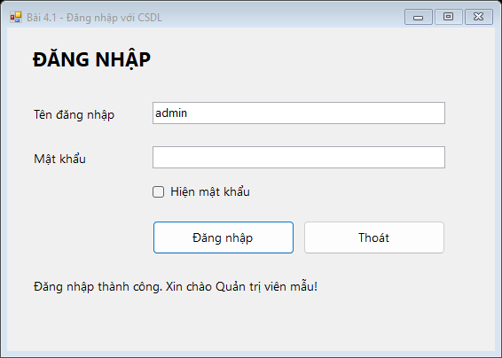
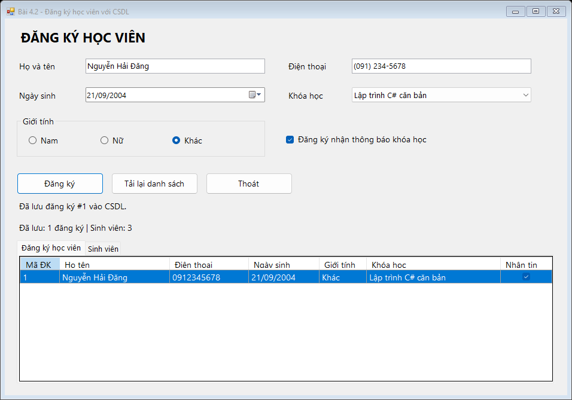
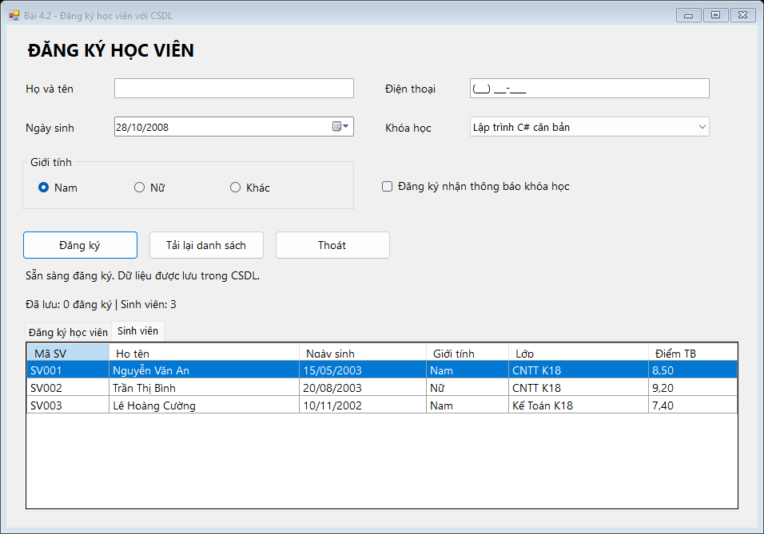

# BÀI TẬP 4.1 VÀ 4.2 - LẬP TRÌNH WINDOWS FORMS

## Thông tin sinh viên

- Họ tên: **Nguyễn Hải Đăng**
- Mã sinh viên: **24810320310**
- Công nghệ: C#, .NET Framework 4.8, SQL Server LocalDB.
- Repository: https://github.com/NguyenHaiDang04/laptrinh.net

| Bài tập | Mã nguồn |
|---|---|
| 4.1 - Form đăng nhập | [Bai4_1_Login](src/Bai4_1_Login) |
| 4.2 - Form đăng ký học viên | [Bai4_2_Registration](src/Bai4_2_Registration) |

## Bài 4.1 - Form đăng nhập

- Nhập tên đăng nhập và mật khẩu; thông báo dữ liệu trống bằng ErrorProvider.
- Checkbox hiện hoặc ẩn mật khẩu.
- Enter để đăng nhập, Esc để thoát.
- Kiểm tra tài khoản trong bảng `AppUsers`. Mật khẩu lưu dưới dạng hash PBKDF2 và salt.
- Lưu kết quả đăng nhập vào `LoginAttempts`, cập nhật thời điểm đăng nhập cuối.



## Bài 4.2 - Form đăng ký học viên

- Nhập họ tên, điện thoại, ngày sinh, giới tính, khóa học và lựa chọn nhận thông báo.
- Điện thoại dùng MaskedTextBox với mask `(000) 000-0000`.
- Ngày sinh hiển thị `dd/MM/yyyy`.
- ComboBox khóa học nạp từ CSDL, sử dụng DisplayMember và ValueMember.
- Bấm Đăng ký để lưu vào bảng `Registrations` và hiển thị MessageBox tổng hợp.
- Không cho đăng ký trùng số điện thoại trong cùng một khóa học.
- Tab **Sinh viên** hiển thị dữ liệu từ bảng `SinhVien`; nút Tải lại danh sách đọc lại dữ liệu từ CSDL.





## Cơ sở dữ liệu

Tên CSDL: **ql_sinhvien**. Server: **(localdb)\MSSQLLocalDB**.

| Bảng | Nội dung |
|---|---|
| AppUsers | Tài khoản đăng nhập |
| LoginAttempts | Nhật ký đăng nhập |
| Courses | Danh mục khóa học |
| Registrations | Thông tin đăng ký học viên |
| SinhVien | Mã sinh viên, họ tên, ngày sinh, giới tính, lớp, điểm trung bình |

Bảng `SinhVien` gồm các cột `MaSV`, `HoTen`, `NgaySinh`, `GioiTinh`, `Lop`, `DiemTB`. Các trường tiếng Việt sử dụng NVARCHAR; điểm trung bình có kiểu DECIMAL(4,2).

| Mã SV | Họ tên | Ngày sinh | Giới tính | Lớp | Điểm TB |
|---|---|---|---|---|---|
| SV001 | Nguyễn Văn An | 15/05/2003 | Nam | CNTT K18 | 8.50 |
| SV002 | Trần Thị Bình | 20/08/2003 | Nữ | CNTT K18 | 9.20 |
| SV003 | Lê Hoàng Cường | 10/11/2002 | Nam | Kế Toán K18 | 7.40 |

CSDL và dữ liệu mẫu được tạo ở lần chạy đầu. Khi chạy lại, chương trình chỉ bổ sung mã sinh viên chưa có, không ghi đè dữ liệu đã sửa.

- Script chạy trong SQL Server Management Studio: [Create_ql_sinhvien.sql](Create_ql_sinhvien.sql).
- Script ứng dụng sử dụng: [Schema.sql](src/Shared/Database/Schema.sql).
- File dữ liệu mặc định: `%LOCALAPPDATA%\LTNET\BaiTap4_CSDL\ql_sinhvien.mdf`.

## Hướng dẫn chạy

1. Cài Visual Studio 2022 hoặc mới hơn, workload **.NET desktop development**, .NET Framework 4.8 Targeting Pack và SQL Server Express LocalDB.
2. Tải toàn bộ thư mục `BaiTap4_CSDL` và mở `BaiTap4_CSDL.sln`.
3. Chọn project `Bai4_1_Login` hoặc `Bai4_2_Registration` làm **Startup Project**.
4. Nhấn **F5** để chạy.

Nếu chưa có instance LocalDB, chạy lệnh:

```powershell
SqlLocalDB create MSSQLLocalDB -s
```

Tài khoản mẫu: **admin** / **Admin@123**.

Hai project dùng chung thư viện `Shared`; cần giữ đủ thư mục khi tải bài. Mỗi form có file `.cs`, `.Designer.cs`, `.resx` và mỗi project có `Program.cs` riêng.

## Kiểm tra

Chạy tại thư mục bài tập:

```powershell
.\Verify.ps1
```

Script biên dịch và chạy kiểm tra trên CSDL riêng. Kết quả và dữ liệu đối chiếu:

- [Kết quả kiểm tra](docs/verification.txt)
- [Bảng đánh giá chức năng](docs/DANH_GIA.md)
- [Số bản ghi trong các bảng](docs/database-proof.csv)
- [Dữ liệu sinh viên đọc từ CSDL](docs/sinhvien-proof.csv)

Bộ kiểm tra ghi lại nội dung thông báo để không cần bấm OK; khi chạy chương trình bình thường, thông báo hiển thị bằng MessageBox.

## Cấu hình kết nối

| Biến môi trường | Giá trị mặc định |
|---|---|
| LTNET_SQL_SERVER | `(localdb)\MSSQLLocalDB` |
| LTNET_DB_NAME | `ql_sinhvien` |
| LTNET_DB_DIRECTORY | `%LOCALAPPDATA%\LTNET\BaiTap4_CSDL` |

Nếu đã có dữ liệu ở bản trước, có thể đặt `LTNET_DB_NAME=LTNET_Bai4_CSDL` trước khi chạy để tiếp tục dùng CSDL đó. Chương trình sẽ bổ sung bảng SinhVien vào CSDL đã chọn. CSDL cũ không bị xóa hoặc tự chuyển dữ liệu sang CSDL mới.

Thư mục `bin`, `obj`, `.vs`, file MDF/LDF và dữ liệu kiểm tra không đưa vào Git.
