# Bài tập 5.3 – 5.4 – 5.5: ADO.NET, WinForms và SQL Server

## MỤC 1: THÔNG TIN SINH VIÊN

- **Họ và tên:** Nguyễn Hải Đăng
- **Mã sinh viên:** 24810320310
- **Lớp:** D19QTANM1
- **Bài 5.3:** Hệ thống quản lý quán cà phê và bán hàng (CafePOS).
- **Bài 5.4:** Hệ thống quản lý tiện ích dịch vụ và khách sạn (HotelManagement).
- **Bài 5.5:** Hệ thống quản lý quy trình xuất nhập kho nguyên vật liệu (InventoryManagement).

Các bài này làm theo đề PDF về CSDL/ADO.NET. Các bài WinForms 5.3, 5.4 trước đây trong `WindowsForms/` là đề khác.

## MỤC 2: HƯỚNG DẪN CÀI ĐẶT & CHẠY DỰ ÁN

### Điều kiện

- Windows 10/11, Visual Studio 2022, workload **.NET desktop development**, .NET Framework **4.8 Developer Pack**.
- SQL Server Express/Developer hoặc SQL Server Express LocalDB; SSMS để chạy script.
- Không cần cài NuGet: sử dụng `System.Data.SqlClient` của .NET Framework.

### Cài đặt

1. Tải/clone toàn bộ repository. Trong SSMS, kết nối SQL Server của máy (mặc định dự án: `(localdb)\MSSQLLocalDB`). Chạy **toàn bộ** [Database/ScriptDB.sql](../Database/ScriptDB.sql) để tạo `CafePOSDB`, `HotelDB`, `InventoryDB` cùng dữ liệu mẫu. Script không xóa CSDL và không chèn lặp dữ liệu khi chạy lại trên schema do script này tạo.
2. Mở [BaiTap5_CSDL.sln](BaiTap5_CSDL.sln) bằng Visual Studio 2022.
3. Sửa `connectionStrings` trong `App.config` của ứng dụng muốn chạy. Ví dụ SQL Server Express: `Data Source=.\SQLEXPRESS;Initial Catalog=CafePOSDB;Integrated Security=True;Encrypt=False`. Đổi catalog tương ứng cho hai bài còn lại. Không commit mật khẩu SQL Server.
4. Nhấp phải `CafePOS`, `HotelManagement` hoặc `InventoryManagement` → **Set as Startup Project** → Build → F5. Không chọn `Shared` hoặc `Verification` khi chạy ứng dụng thông thường.

### Cấu trúc và phân tầng

```text
Database/ScriptDB.sql              # ở thư mục gốc repository
BaiTap5_CSDL/
├── CafePOS/                       # Bài 5.3
│   ├── DTO/  DAL/  BUS/  GUI/
│   ├── Program.cs
│   └── App.config
├── HotelManagement/               # Bài 5.4, cùng cấu trúc
├── InventoryManagement/           # Bài 5.5, cùng cấu trúc
├── Shared/                        # DTO/DAL/BUS/GUI dùng chung
├── Verification/                  # kiểm tra tích hợp với SQL Server thật
├── images/                        # ảnh form thực tế + nhật ký kiểm tra
├── Verify.ps1
├── README.md
└── BaiTap5_CSDL.sln
```

Luồng xử lý: **GUI → BUS → DAL → SQL Server**; DTO chuyển dữ liệu giữa các lớp. GUI không có câu lệnh SQL. CRUD dùng `CatalogBus` kiểm tra dữ liệu và `CatalogDal` thao tác qua `SqlConnection`, `SqlCommand`, `SqlDataReader`. Nạp dữ liệu ngắt kết nối dùng `SqlDataAdapter.Fill(DataSet)` và `DataTable`.

### Chạy từng bài

**5.3 – CafePOS**

1. Chọn nút bàn trên sơ đồ: xanh = trống, đỏ = có khách. Chi tiết hóa đơn của bàn được bind vào DataGridView.
2. Chọn danh mục → món → số lượng → **Thêm món**. Món trùng được cộng số lượng; lưu đơn giá lúc gọi món lần đầu.
3. Chọn bàn đích trống → **Đổi bàn**. Hóa đơn chuyển bàn và trạng thái hai bàn cập nhật trong một transaction.
4. **Thanh toán** → xác nhận. Tính tổng từ chi tiết trong CSDL, lưu giờ ra/tổng tiền/trạng thái và giải phóng bàn trong một `SqlTransaction`.
5. Tab **Quản lý danh mục**, **Quản lý thực đơn**: Tạo mới/Lưu/Xóa/Tìm kiếm. Mã danh mục của món lấy ở tab danh mục. Không chấp nhận tên trống, giá âm; không xóa món/danh mục đang được tham chiếu.
6. Tab **Báo cáo hóa đơn** hiển thị các hóa đơn đã thanh toán.

**5.4 – HotelManagement**

1. Chọn phòng; nhập CCCD 12 số → **Tra cứu khách**. Khách mới nhập thêm họ tên, số điện thoại → **Nhận phòng**. Khách cũ tái sử dụng mã khách; phiếu nhận phòng và trạng thái phòng lưu cùng transaction.
2. Tab **Gọi dịch vụ** thêm dịch vụ cho phòng đã chọn ở tab đầu. `ServiceDto` được chuyển qua BUS/DAL; lưu đơn giá dịch vụ tại thời điểm sử dụng.
3. **Xem tiền tạm** hoặc **Thanh toán / Trả phòng**. Quy ước tính giờ: làm tròn lên từng giờ, tối thiểu 1 giờ. Tổng = số giờ × giá phòng lưu khi nhận phòng + chi phí dịch vụ.
4. Thanh toán lưu ngày trả/tổng tiền và đổi phòng sang **Đang dọn dẹp** trong một transaction. Khi dọn xong bấm **Đã dọn xong** để đưa phòng về Trống.
5. Tab **Hóa đơn** xem và xuất hóa đơn `.txt`; tab **Báo cáo lưu trú** xem lịch sử đã trả phòng. Danh sách phòng được lọc tại bộ nhớ bằng `DataView.RowFilter` theo loại và trạng thái, không truy vấn lại CSDL mỗi lần lọc.

**5.5 – InventoryManagement**

1. CRUD vật tư và nhà cung cấp ở hai tab tương ứng. Tồn kho không cho sửa tay trong CRUD: vật tư mới có tồn 0, tăng/giảm bằng phiếu. Số điện thoại nhà cung cấp không bắt buộc nhưng phải duy nhất khi có nhập.
2. Chọn **NHAP** (bắt buộc nhà cung cấp) hoặc **XUAT** → chọn vật tư, số lượng, đơn giá → **Thêm dòng**. Mỗi mã vật tư có một dòng trên phiếu.
3. **Lưu phiếu kho**: một transaction lưu header, chi tiết, cập nhật tồn. Xuất kho dùng `UPDATE ... WHERE SoLuongTon >= @sl`; nếu thiếu hàng ở bất kỳ dòng nào thì rollback cả phiếu và cả những dòng đã xử lý trước.
4. Tab **Báo cáo / Cảnh báo** lọc các vật tư có tồn nhỏ hơn ngưỡng nhập trên màn hình. Tổng giá trị tồn dùng `ExecuteScalar(SUM(SoLuongTon*GiaTonKho))`.
5. Giá vốn tồn được tính **bình quân gia quyền sau mỗi lần nhập**, làm tròn 2 số thập phân; xuất kho giữ nguyên giá vốn bình quân. Đơn giá xuất trên phiếu là đơn giá giao dịch, không thay thế giá vốn tồn.

### Thiết kế CSDL và đảm bảo nhất quán

- Đề đánh số bảng không thống nhất: Cafe thực tế cần 5 bảng, Hotel 5 bảng, Inventory 4 bảng theo các thực thể được liệt kê. Script tạo đầy đủ các thực thể đó.
- Bổ sung `GiaPhong` cho phiếu khách sạn, `DonGia` và khóa dòng cho sử dụng dịch vụ để lưu giá lịch sử; bổ sung `GiaTonKho` để có cơ sở tính giá trị tồn.
- Khóa chính, khóa ngoại, CHECK số lượng/giá, index duy nhất bảo đảm một hóa đơn đang mở mỗi bàn, một phiếu đang lưu trú mỗi phòng, CCCD và điện thoại nhà cung cấp không trùng.
- Giao dịch dùng `Serializable`, khóa `UPDLOCK/HOLDLOCK`, `Commit` khi hoàn tất và `Rollback` khi lỗi. Giá và tổng tiền đọc/tính trong transaction, không tin tổng hiển thị trên GUI.
- Các giá trị người dùng được bind bằng `SqlParameter`. Tên bảng/cột CRUD chỉ lấy từ định nghĩa cố định trong BUS. Từ khóa LIKE được escape; bộ lọc DataView escape dấu nháy.

## MỤC 3: HÌNH ẢNH KẾT QUẢ CÁC MÀN HÌNH CHỨC NĂNG

Ảnh do chương trình kiểm tra mở **form WinForms thực tế với SQL Server LocalDB**, rồi chụp nội dung control bằng `DrawToBitmap`. Ảnh không phải mockup, không dùng lại ảnh bài cũ. Kết quả kiểm tra có trong [images/verification.txt](images/verification.txt); nếu workflow chưa thành công thì xem lỗi ở tab Actions, không coi ảnh thiếu là đã xác minh.

### Bài 5.3 – Quán cà phê

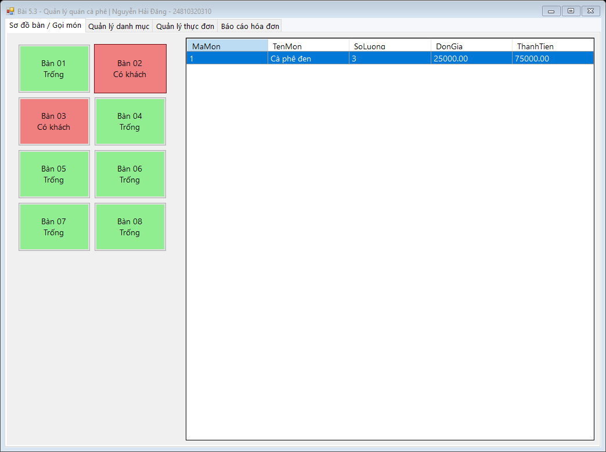
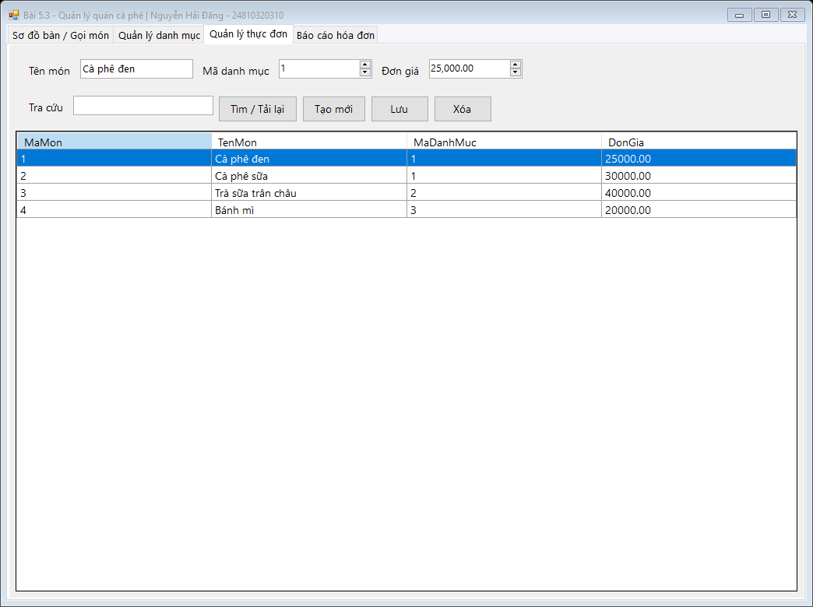

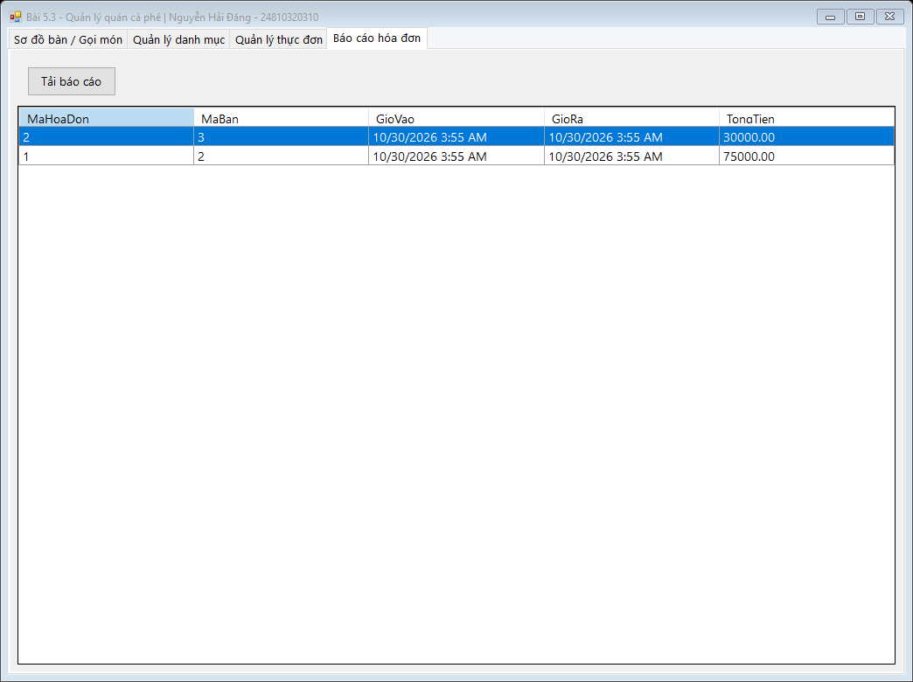
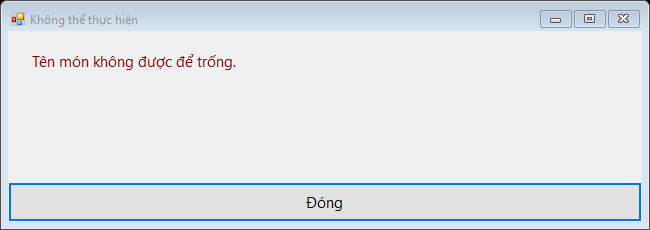

### Bài 5.4 – Khách sạn

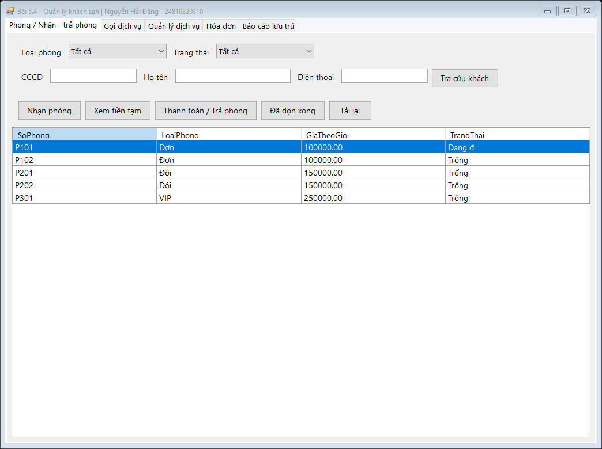
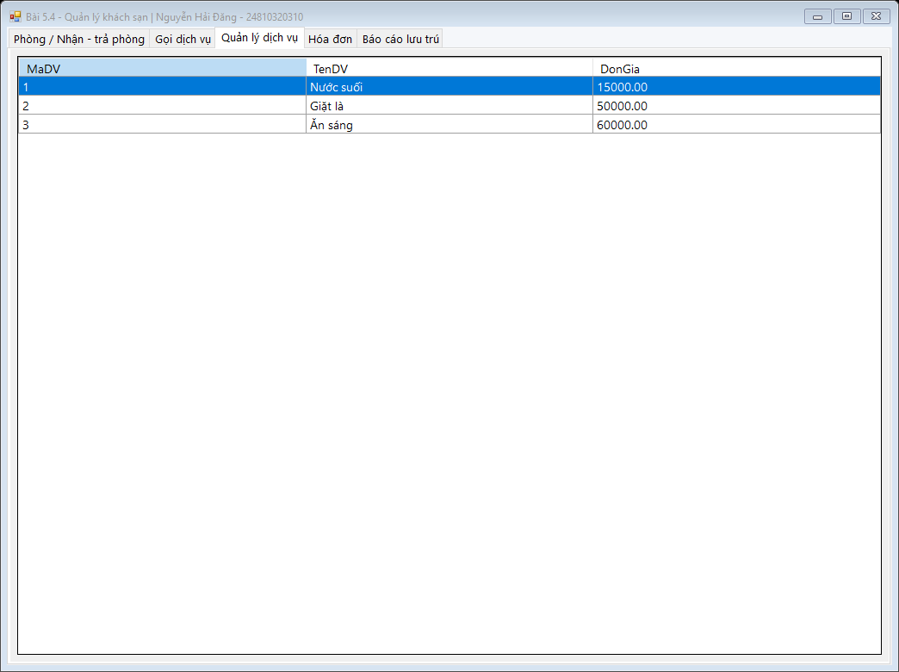
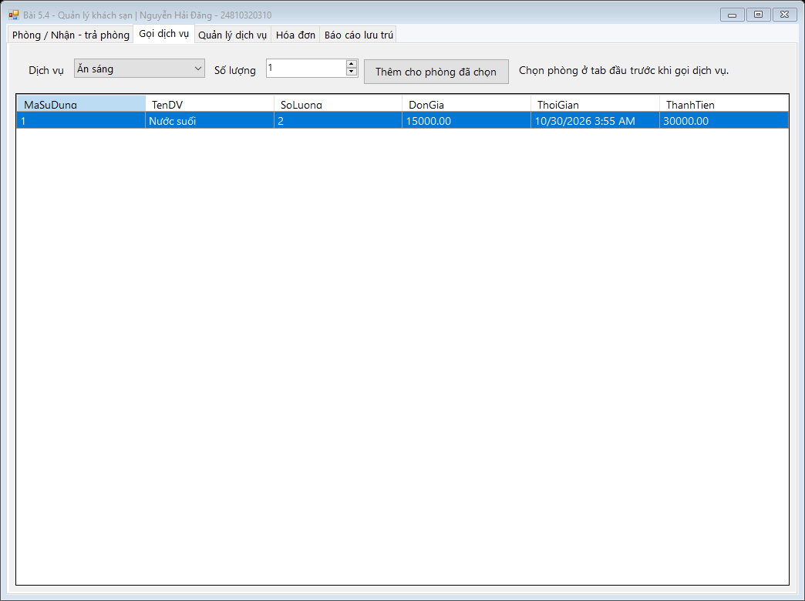
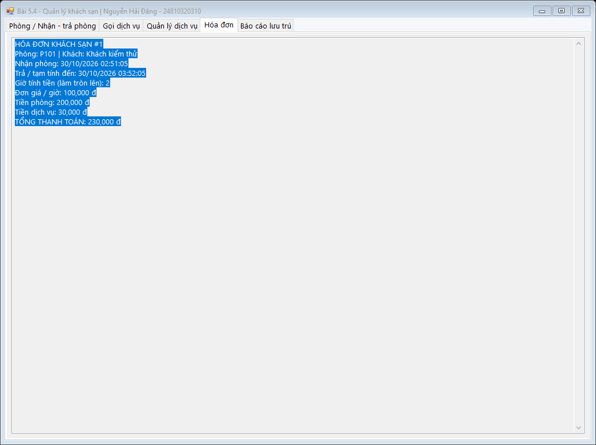
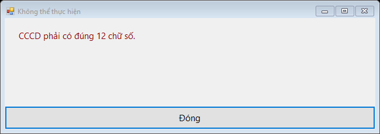

### Bài 5.5 – Xuất nhập kho

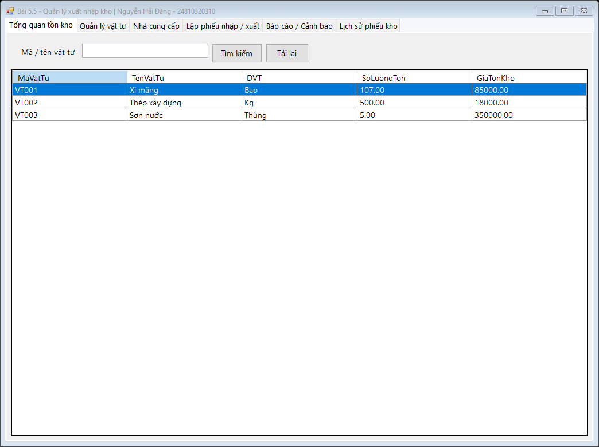
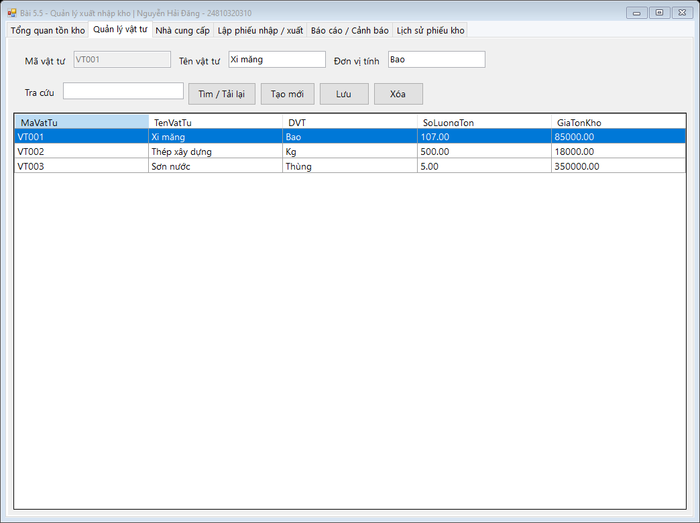
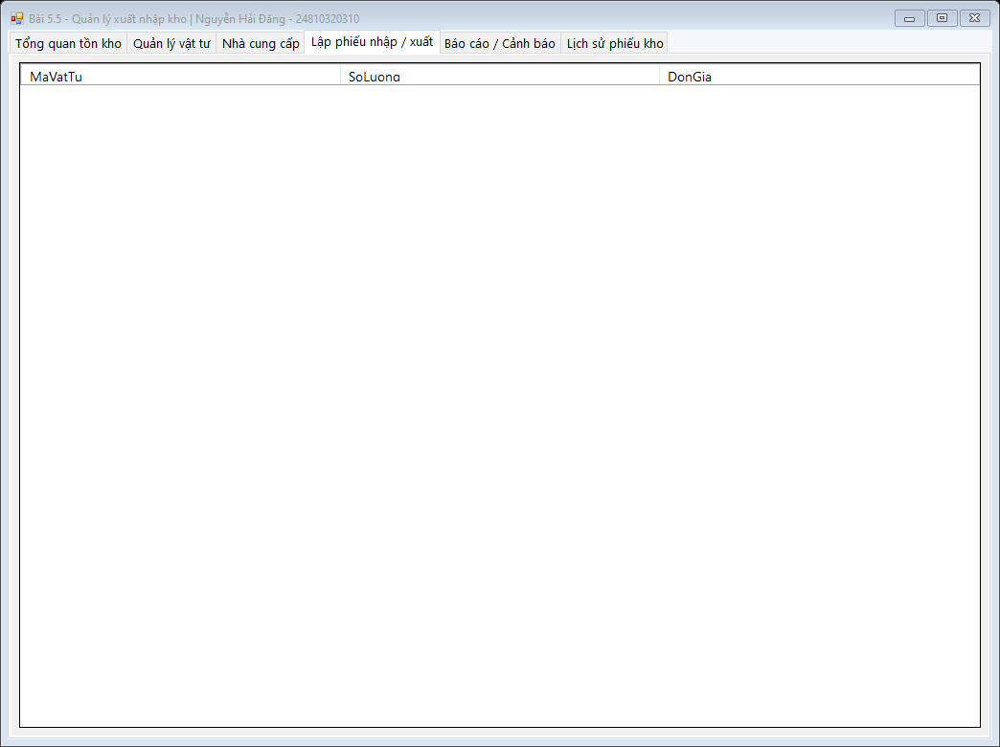
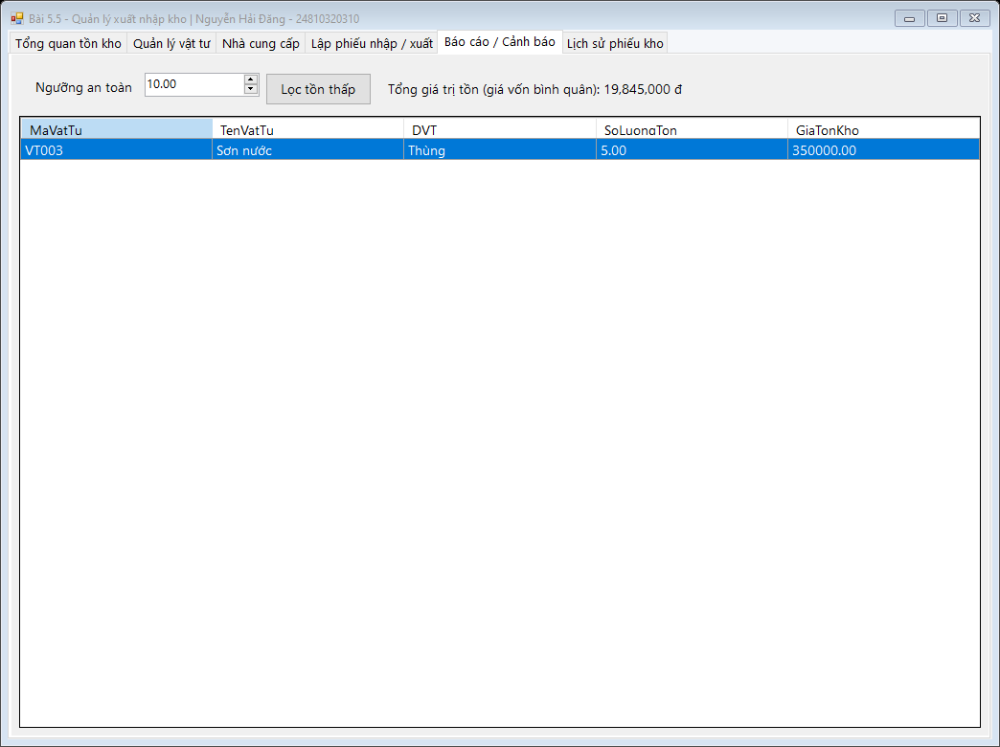
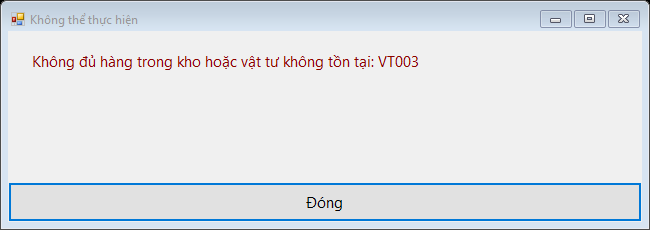

## MỤC 4: KIỂM TRA VÀ TÁI HIỆN KẾT QUẢ

Mở **Developer PowerShell for VS 2022**, tại thư mục repository:

```powershell
.\BaiTap5_CSDL\Verify.ps1
```

Script tạo instance LocalDB và tệp dữ liệu tạm riêng, thực thi script SQL, build solution, chạy kiểm tra tích hợp và chụp form; cuối cùng dừng/xóa instance tạm. Không sử dụng CSDL người dùng đã cấu hình để chạy kiểm tra. Cần cài `SqlLocalDB.exe` và `msbuild` trong PATH. Khi kiểm tra thất bại, script trả mã lỗi và ghi nguyên nhân trong `images/verification.txt`.

Các ca kiểm tra bao gồm CRUD, tìm kiếm tham số, cộng món trùng, đổi bàn, tổng tiền, chống thanh toán lặp, CCCD và nhận khách cũ, làm tròn giờ, cộng phí dịch vụ, trạng thái dọn phòng, lọc DataView, nhập/xuất kho, định giá tồn và rollback đa dòng. Chuỗi SQL Injection được gửi thực tế vào hàm tìm kiếm, sau đó xác nhận bảng và dữ liệu còn nguyên.

[GitHub Actions](https://github.com/NguyenHaiDang04/laptrinh.net/actions/workflows/baitap5-csdl.yml) chạy cùng script trên Windows. Khi tất cả kiểm tra thành công ở `master`, workflow commit ảnh và nhật ký vào `BaiTap5_CSDL/images/`. Artifact `BaiTap5-ket-qua-chay-that` lưu cùng kết quả để tải về.
