# Bài 6.6–6.7–6.8: Thư viện, phòng khám và câu lạc bộ bida

## 1. Thông tin sinh viên

- **Họ tên:** Nguyễn Hải Đăng
- **Mã sinh viên:** 24810320310
- **Lớp:** D19QTANM1
- **Bài 6.6:** Library Management System.
- **Bài 6.7:** Clinic & Pharmacy Management System.
- **Bài 6.8:** Billiards Club Management System.

## 2. Cài đặt

1. Cài Visual Studio 2022, workload **.NET desktop development**, .NET Framework **4.8 Developer Pack**, SQL Server/LocalDB và SSMS.
2. Trong SSMS chạy [Database/ScriptDB.sql](Database/ScriptDB.sql) của thư mục bài này để tạo LibraryDB, ClinicDB, BilliardsDB và dữ liệu mẫu. Script không DROP hay xóa dữ liệu cũ. Các bảng mới chỉ được tạo và seed ở lần chạy đầu.
3. Mở [BaiTap668.sln](BaiTap668.sln) (hoặc solution cùng tên ở gốc repository).
4. Sửa connectionStrings trong App.config của project tương ứng. Mặc định là `(localdb)\\MSSQLLocalDB`, Windows Authentication. Nếu dùng SQL Server Express, đổi Data Source thành `.\\SQLEXPRESS`.
5. Chọn **Library**, **Clinic** hoặc **Billiards** làm Startup Project → Build → F5. Không chọn Shared hoặc Verification.

Không cần NuGet. ADO.NET sử dụng System.Data.SqlClient của .NET Framework. Mỗi project có DTO, DAL, BUS, GUI, Program.cs, App.config. MainForm có đủ **MainForm.cs / MainForm.Designer.cs / MainForm.resx** và metadata DependentUpon trong .csproj để mở bằng View Designer. Các tab CRUD được gắn CatalogPanel dùng chung khi chạy; Designer hiển thị vùng chứa các tab này và không kết nối CSDL.

```text
BaiTap668/
  Database/ScriptDB.sql
  Library/     DTO/ DAL/ BUS/ GUI/ Program.cs App.config Library.csproj
  Clinic/      DTO/ DAL/ BUS/ GUI/ Program.cs App.config Clinic.csproj
  Billiards/   DTO/ DAL/ BUS/ GUI/ Program.cs App.config Billiards.csproj
  Shared/      DTO/ DAL/ BUS/ GUI/
  Verification/
  images/
  BaiTap668.sln
  Verify.ps1
  README.md
```

GUI gọi BUS; BUS kiểm tra dữ liệu và chuyển DTO cho DAL. Giá trị đầu vào được bind bằng SqlParameter. CRUD chỉ lấy tên bảng/cột từ định nghĩa cố định. Shared được phát triển từ thư viện dùng chung của bài 6.1–6.2, bản namespace riêng để không ảnh hưởng bài cũ.

## 3. Hướng dẫn chức năng

### Bài 6.6 – Thư viện

- **Quản lý đầu sách / độc giả:** thêm, sửa, xóa, tìm kiếm; số lượng sách là số nguyên không âm; email duy nhất; hạn thẻ nhập yyyy-MM-dd.
- **Lập phiếu mượn:** chọn độc giả, hạn trả, đầu sách và số lượng → Thêm sách → Lưu phiếu. Sách trùng được gộp. Hạn thẻ được kiểm tra với GETDATE trên SQL Server, hạn trả phải ở tương lai. Một transaction tạo phiếu, chi tiết và trừ sách. Thiếu bất kỳ sách nào rollback toàn bộ.
- **Phiếu mượn:** lọc theo độc giả và trạng thái (Tất cả/Đang mượn/Đã trả/Quá hạn). Trả sách xác nhận hoàn trả **toàn bộ phiếu**, cập nhật trạng thái bằng parameterized UPDATE và cộng lại số sách trong cùng transaction. Không cho trả hai lần.
- **Cảnh báo quá hạn:** dùng SqlDataReader đọc những phiếu HanTra < GETDATE và chưa trả. Khi tải danh sách, cập nhật phiếu đang mượn đã quá hạn thành Quá hạn; phiếu này vẫn trả được bình thường.
- **Thống kê:** GROUP BY thể loại, đếm số phiếu khác nhau trong mỗi thể loại và tổng số cuốn đã mượn; bao gồm cả lịch sử phiếu đã trả.

### Bài 6.7 – Phòng khám

- **Tiếp nhận:** nhập điện thoại → Tra cứu. Khách mới nhập họ tên/năm sinh/triệu chứng; khách cũ tái sử dụng mã bệnh nhân → Tạo hồ sơ khám. Điện thoại 9–15 chữ số, năm sinh hợp lệ.
- **Danh mục thuốc:** CRUD, cập nhật giá và số lượng tồn; không được âm hoặc nhập tồn lẻ. Có thể nhập thêm tồn bằng tăng số lượng tồn trong CRUD; lớp BUS/DAL cũng có Restock để cộng số lượng nguyên dương.
- **Kê đơn:** chọn mã hồ sơ, nhập chẩn đoán và tiền khám; thêm từng thuốc kèm số lượng/liều dùng → Lưu & Xuất đơn. Một hồ sơ có một đơn; đơn không thuốc vẫn cho phép để thu tiền khám. Transaction tạo đơn, chi tiết, trừ tồn và lưu chẩn đoán. Thiếu thuốc rollback toàn bộ, không trừ riêng các dòng trước đó.
- **Thanh toán:** chọn đơn ở tab Đơn thuốc → Thanh toán. Tổng = tiền khám + số lượng × đơn giá thuốc. Chi tiết đơn lưu **DonGia tại thời điểm kê** để không đổi hóa đơn cũ khi sửa giá thuốc. Không cho thanh toán hai lần.
- **In hóa đơn:** Xem hóa đơn → Xem trước / In dùng PrintDocument và PrintPreviewDialog, có chia trang; cần máy in hoặc máy in PDF được cài trên Windows. Có thể xuất TXT. Dữ liệu bệnh nhân và tên thuốc trong script là dữ liệu giả để thực hành, không phải đơn điều trị thực tế.

### Bài 6.8 – Bida

- **Sơ đồ bàn:** nút xanh là Trống, cam là Đang chơi. Chọn bàn → Mở bàn; transaction tạo hóa đơn với GETDATE và đổi trạng thái bàn. Ngăn mở bàn trùng bằng khóa giao dịch và unique index hóa đơn đang mở.
- **Gọi dịch vụ:** chọn món và số lượng → Thêm / Tăng món. SqlDataAdapter nạp DataTable lên lưới; có thể sửa **SoLuong** trực tiếp. Lưu dịch vụ trước khi đổi bàn; nếu muốn bỏ các thay đổi chưa lưu sẽ có xác nhận. Label tổng hiển thị các dịch vụ **đã lưu**, cập nhật thời gian mỗi giây.
- **Thanh toán:** lưu dịch vụ rồi tính thời gian theo **block 15 phút làm tròn lên, tối thiểu 1 block**. Ví dụ 31 phút = 3 block = 0,75 giờ. Transaction trừ tồn dịch vụ, lưu giờ kết thúc/tiền giờ/tiền dịch vụ/trạng thái hóa đơn và trả bàn về Trống. Thiếu tồn rollback, bàn và hóa đơn tiếp tục mở.
- **Thuê gậy:** MenuDichVu bổ sung QuanLyTon (bit); 0 = dịch vụ thuê không trừ kho, 1 = hàng tiêu hao. Dữ liệu mẫu Thuê gậy Carbon có QuanLyTon=0. Dịch vụ thêm bằng CRUD mặc định là hàng tiêu hao; muốn tạo loại thuê mới đặt QuanLyTon=0 trong CSDL. Không suy đoán loại dịch vụ bằng tên.
- **Giá lịch sử:** HoaDon bổ sung GiaGio để giữ giá bàn lúc mở; chi tiết giữ DonGia lần đầu lưu dịch vụ. DAL đọc lại đơn giá phía server, không tin giá do lưới gửi lên.
- **Báo cáo hóa đơn:** xem thời gian, tiền giờ, tiền dịch vụ, tổng tiền của những lượt chơi đã thanh toán.

## 4. Hình ảnh chương trình chạy thực tế

Ảnh được tạo từ form WinForms đang chạy với SQL Server LocalDB bằng DrawToBitmap, không phải mockup. [Nhật ký kiểm tra](images/verification.txt) ghi kết quả thực thi. Chức năng in có trong ứng dụng; bộ kiểm tra tự động xác minh nội dung hóa đơn, không gửi lệnh in giấy.

### Thư viện

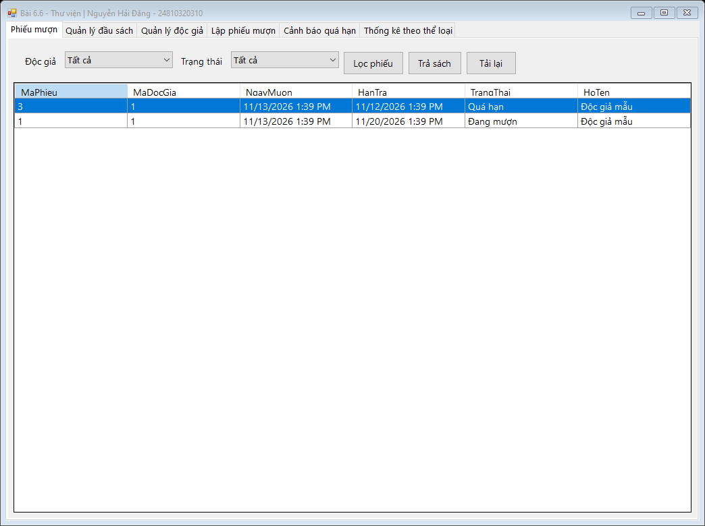
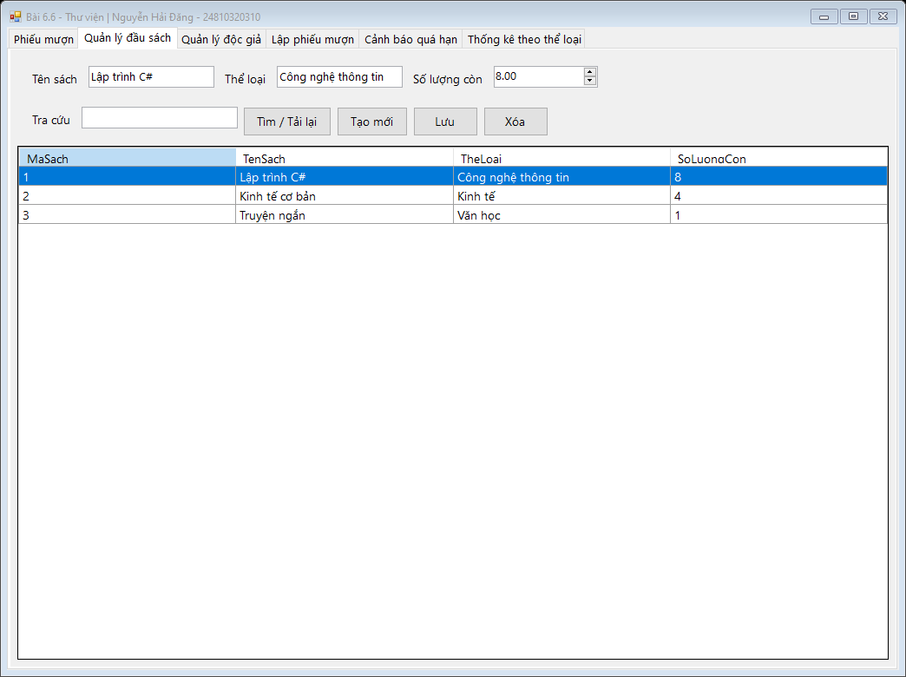
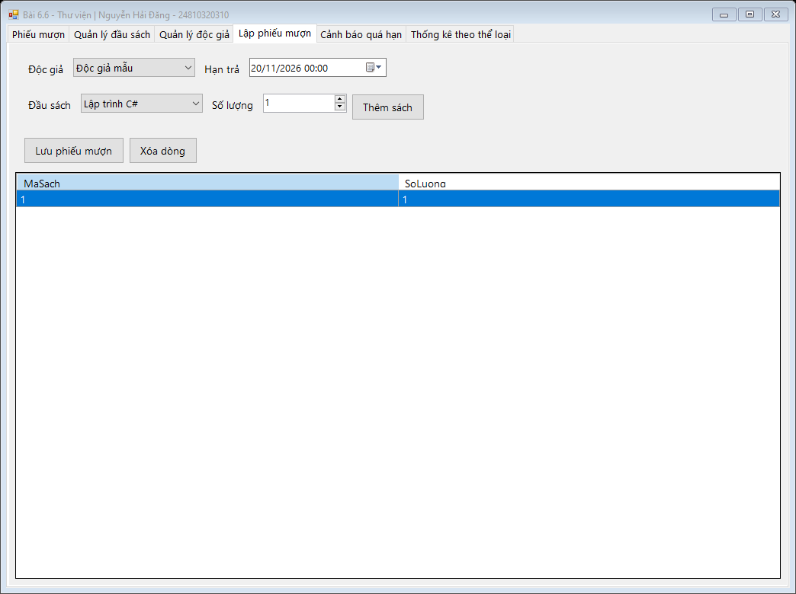
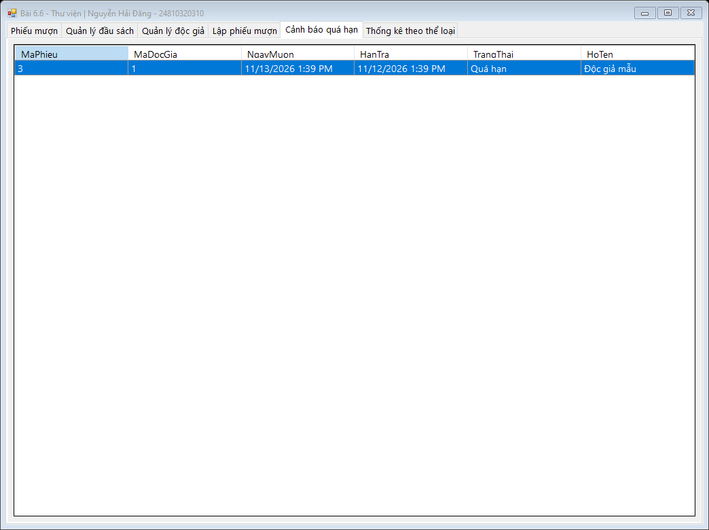
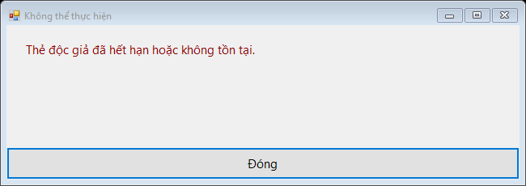

### Phòng khám

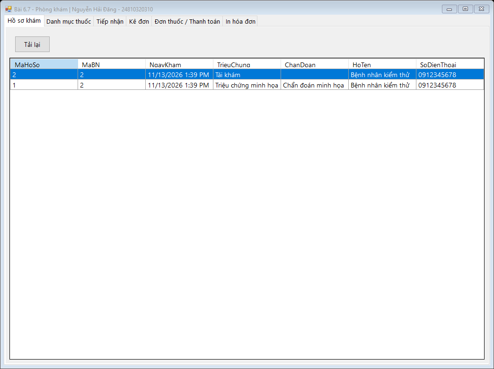
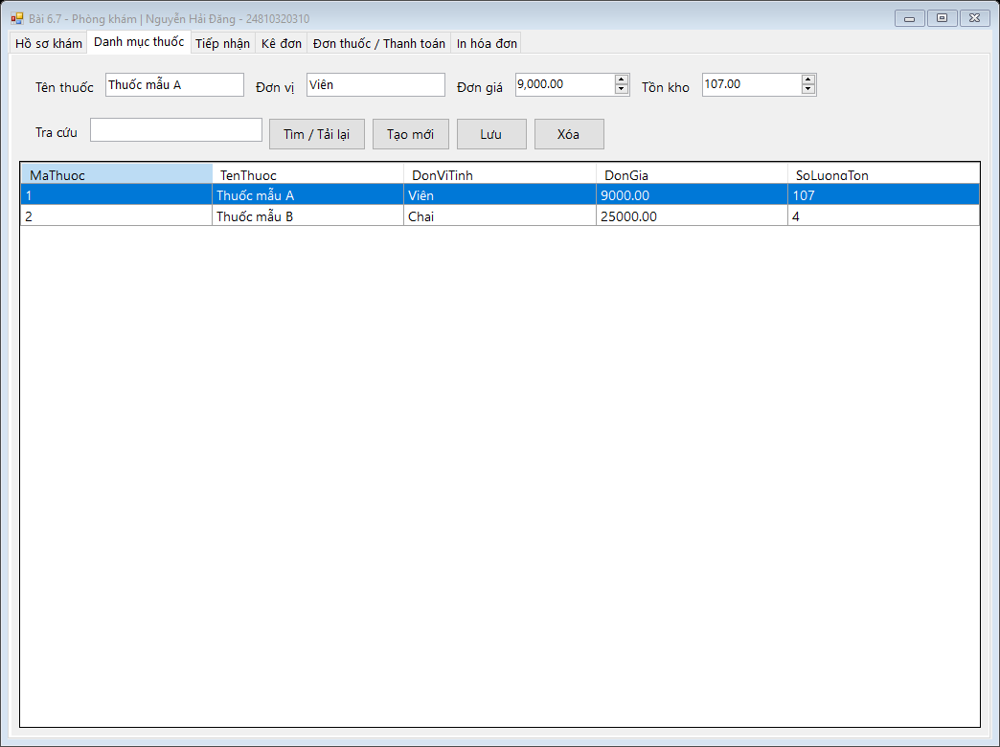
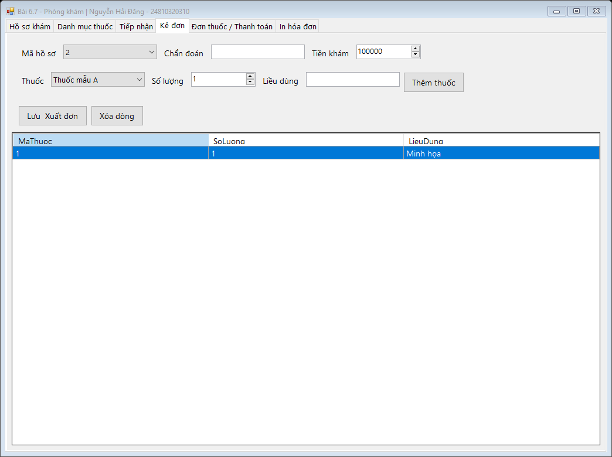
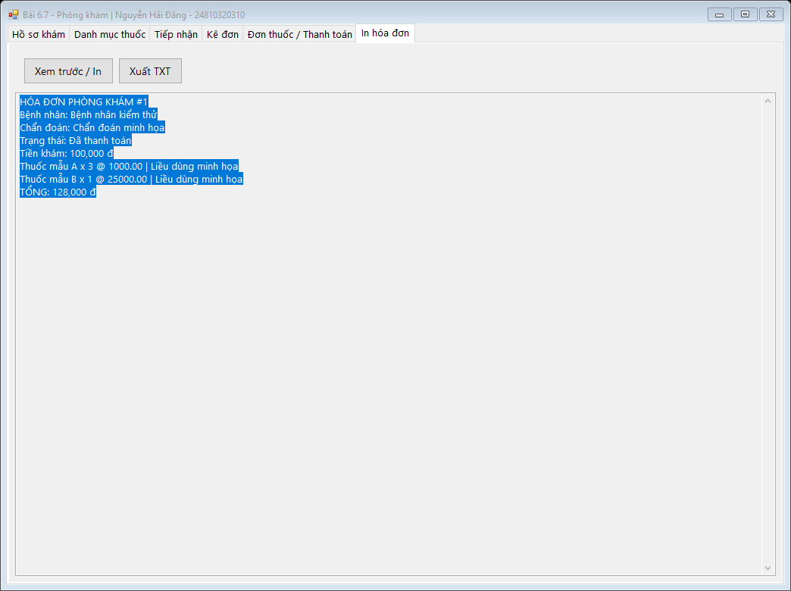
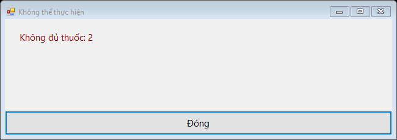

### Bida

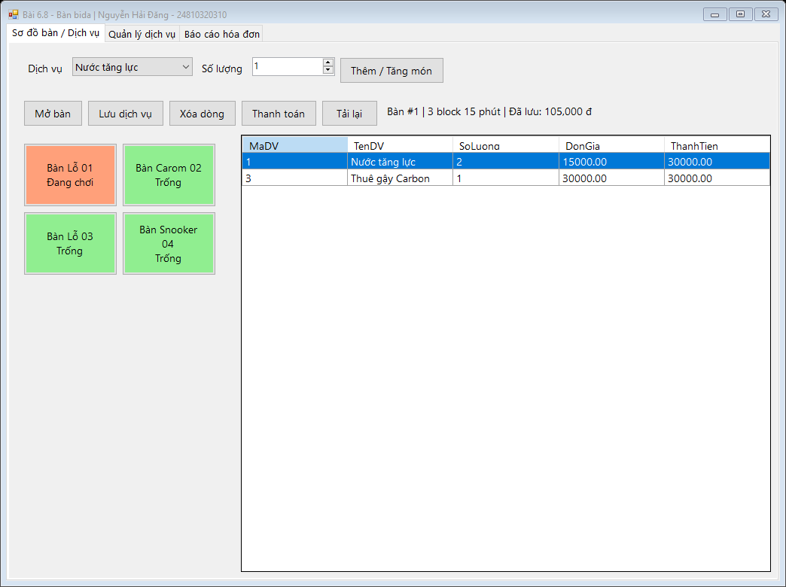
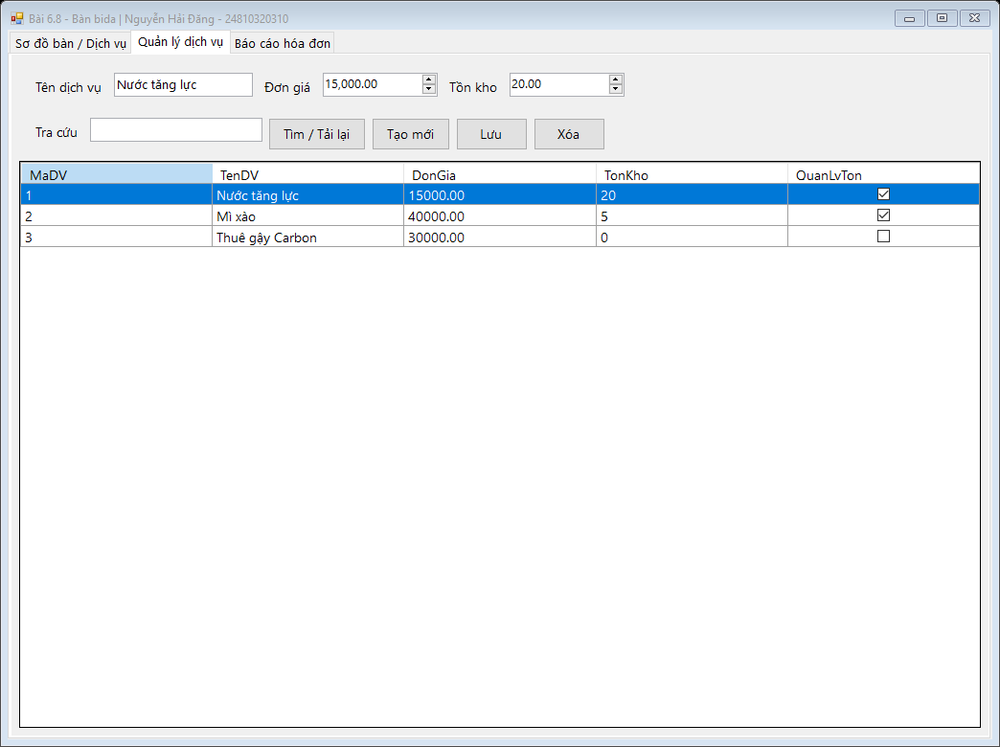

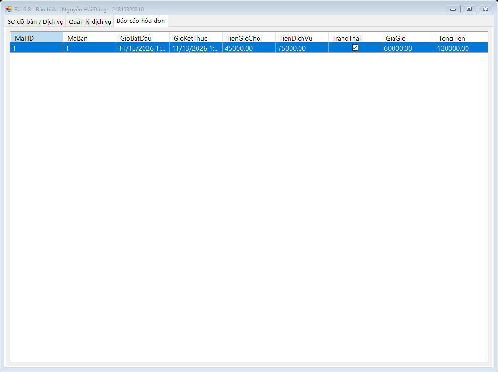
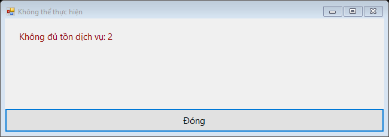

## 5. Kiểm tra và tái hiện

Trong Developer PowerShell for VS 2022, tại thư mục repository:

```powershell
.\\BaiTap668\\Verify.ps1
```

Script tạo SQL Server LocalDB tạm riêng, nạp schema/dữ liệu, build solution, chạy kiểm tra và chụp 15 ảnh form, rồi dừng/xóa instance tạm. Cần msbuild và SqlLocalDB.exe trong PATH. Không chạy kiểm tra lên CSDL cá nhân.

Các ca kiểm tra bao gồm Designer không cần CSDL, CRUD, SQL Injection, hạn thẻ, thiếu sách, trả trùng, quá hạn, thống kê, tiếp nhận bệnh nhân mới/cũ, tổng chi phí, giá thuốc lịch sử, rollback đơn thuốc, thuê gậy không trừ tồn, DataTable tăng số lượng, block giờ và rollback thanh toán. [GitHub Actions](https://github.com/NguyenHaiDang04/laptrinh.net/actions/workflows/baitap668-csdl.yml) chỉ công bố ảnh/log sau khi kiểm tra thành công.

