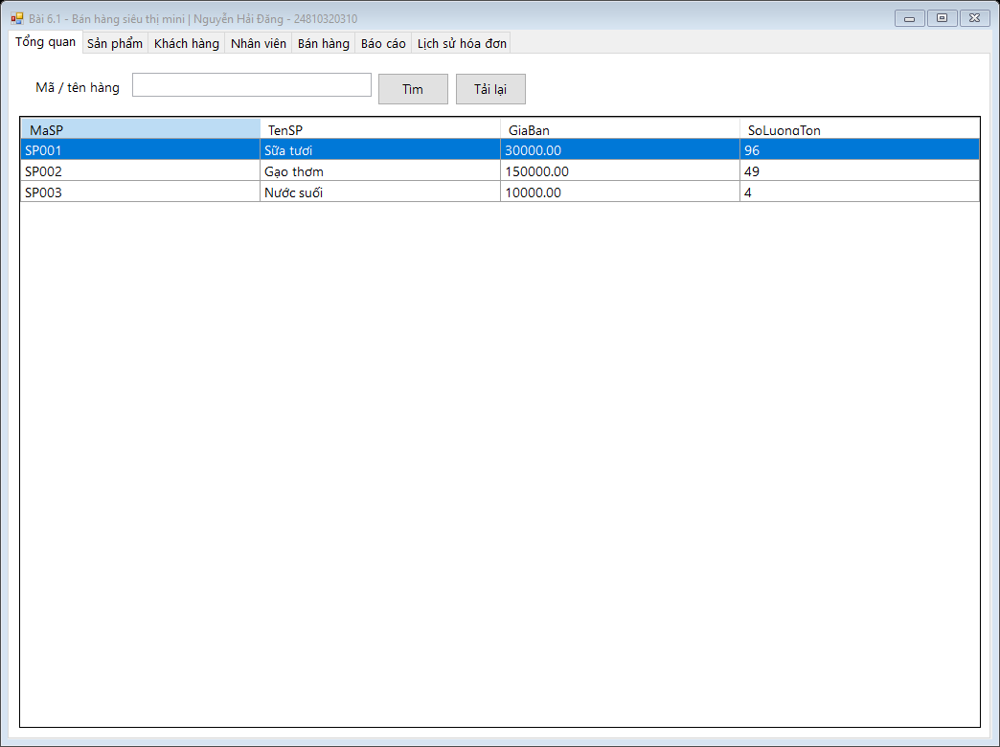
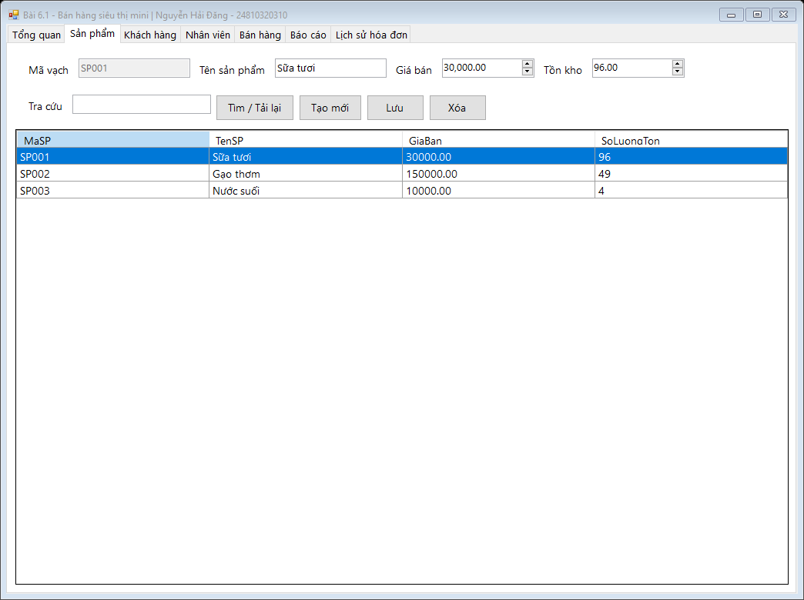
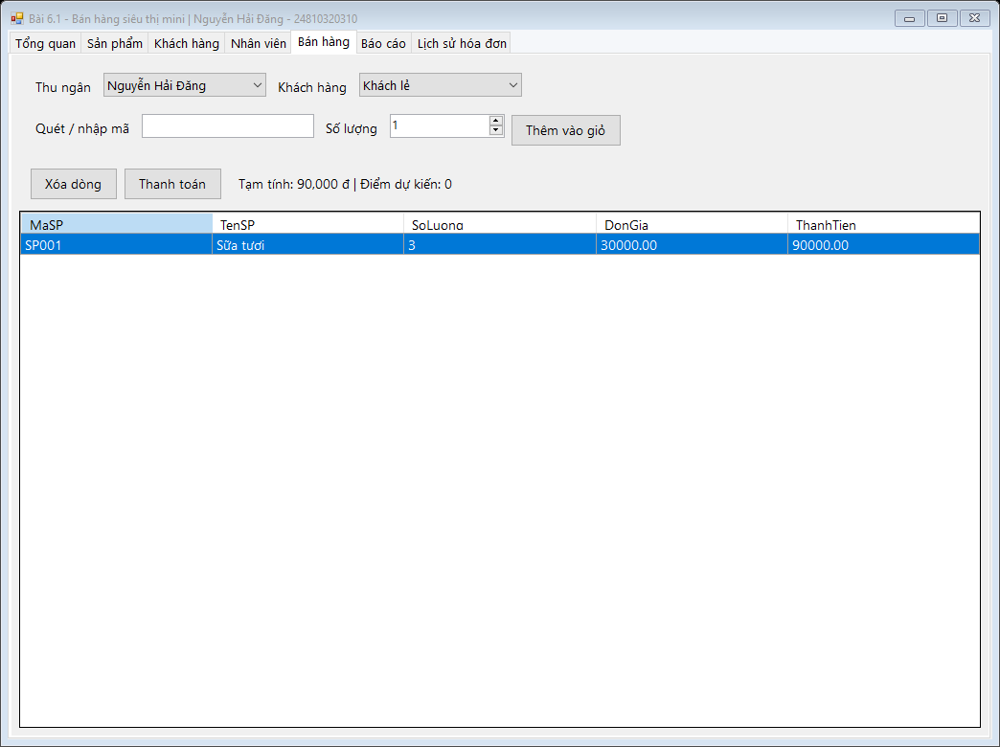
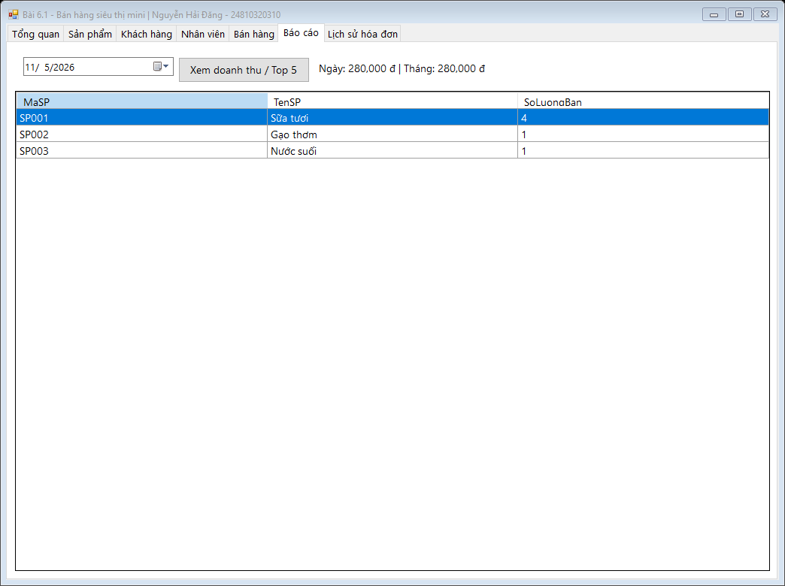
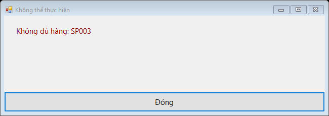
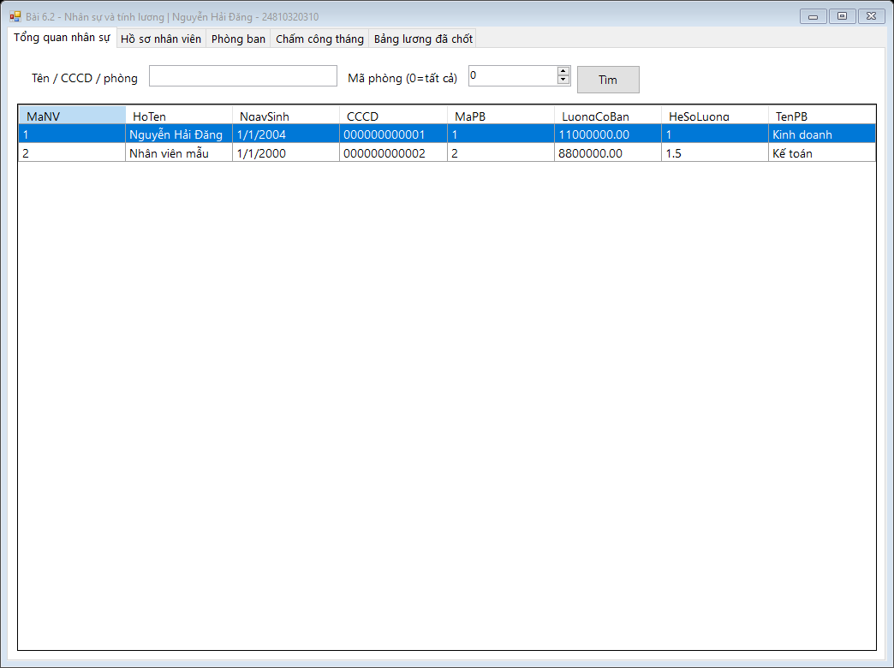
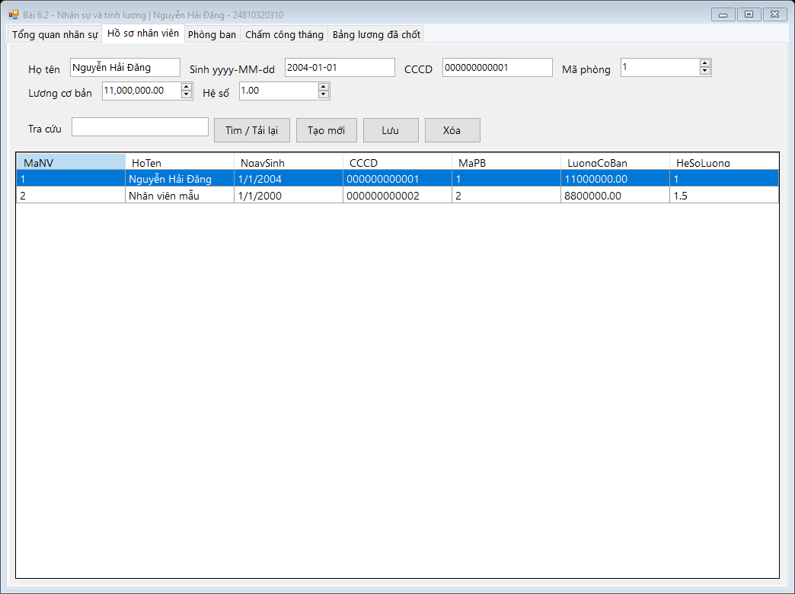
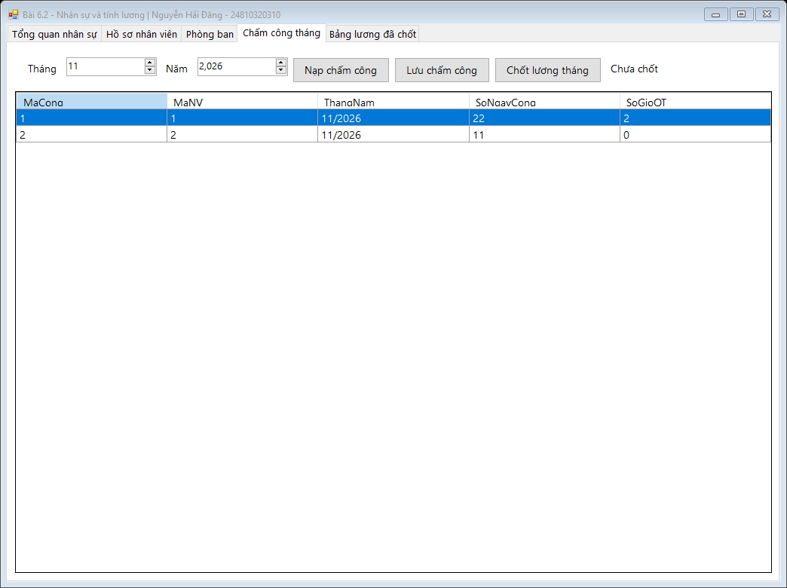
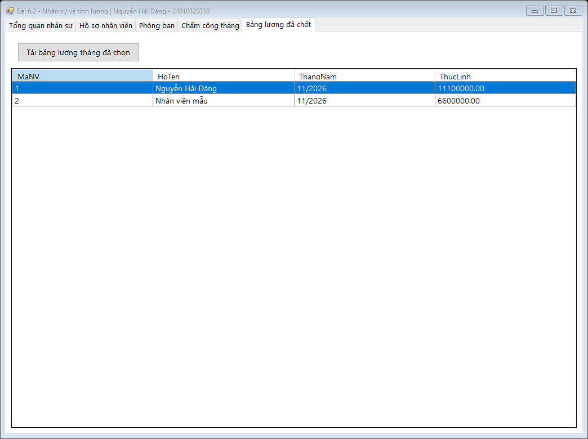
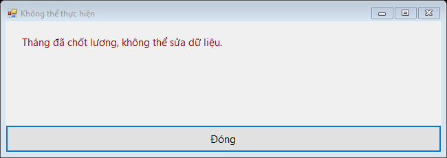

# Bài 6.1–6.2: Bán hàng và quản lý nhân sự

## MỤC 1: THÔNG TIN SINH VIÊN

- Họ tên: **Nguyễn Hải Đăng**
- Mã sinh viên: **24810320310**
- Lớp: **D19QTANM1**
- Bài 6.1: Retail Sales System – quản lý siêu thị mini.
- Bài 6.2: HRM & Payroll System – nhân sự, chấm công, tính lương.

## MỤC 2: HÌNH ẢNH KẾT QUẢ

Ảnh được tạo bằng DrawToBitmap từ form WinForms đang chạy và nạp dữ liệu SQL Server LocalDB thực tế trên Windows. Không dùng mockup. [Nhật ký chạy](images/verification.txt) ghi các ca kiểm tra; ảnh chỉ được công bố khi build và kiểm tra thành công.

### Bài 6.1







### Bài 6.2







## MỤC 3: CÀI ĐẶT VÀ CHẠY

1. Cài Visual Studio 2022, workload **.NET desktop development**, .NET Framework **4.8 Developer Pack**, SQL Server Express/Developer hoặc LocalDB, SSMS.
2. Mở SSMS, chạy [Database/ScriptDB.sql](Database/ScriptDB.sql) trong thư mục bài 6 để tạo SalesDB, HRMDB và dữ liệu mẫu. Bản tổng hợp ở [Database/ScriptDB.sql của repository](../Database/ScriptDB.sql) cũng bao gồm bài 5. Script không xóa dữ liệu đã có.
3. Mở [BaiTap6_CSDL.sln ở gốc kho](../BaiTap6_CSDL.sln). Sửa connectionStrings trong RetailSales/App.config và Payroll/App.config cho SQL Server của máy. Mặc định là `(localdb)\\MSSQLLocalDB`, Windows Authentication.
4. Chọn **RetailSales** hoặc **Payroll** làm Startup Project → Build → F5. Không cần NuGet; dùng System.Data.SqlClient của .NET Framework.

Cấu trúc:

```text
Database/ScriptDB.sql
BaiTap6_CSDL.sln
BaiTap6_CSDL/
  RetailSales/  DTO/ DAL/ BUS/ GUI/ Program.cs App.config
  Payroll/      DTO/ DAL/ BUS/ GUI/ Program.cs App.config
  Shared/       DTO/ DAL/ BUS/ GUI/ (thư viện dùng chung)
  Database/ScriptDB.sql
  Verification/  (kiểm tra tích hợp với SQL Server thật)
  Verify.ps1
  images/
  README.md
```

GUI chỉ gọi BUS; BUS kiểm tra nghiệp vụ và gọi DAL. Các truy vấn sử dụng SqlParameter. Tên bảng/cột CRUD chỉ lấy từ định nghĩa cố định trong BUS, không từ đầu vào người dùng. Thư viện Shared được phát triển từ bài 5, bản riêng cho bài 6 để các bài cũ vẫn chạy độc lập.

### Thao tác bài 6.1

- **Tổng quan**: tìm hàng theo mã vạch hoặc tên, hỗ trợ tìm một phần bằng LIKE và SqlParameter.
- **Sản phẩm / Khách hàng / Nhân viên**: Tạo mới, Lưu, Xóa, Tìm. Giá bán phải dương, tồn là số nguyên không âm; điện thoại 9–15 chữ số và không trùng. Dữ liệu có chứng từ tham chiếu không được xóa.
- **Bán hàng**: chọn thu ngân, khách hàng hoặc Khách lẻ. Nhập/quét mã rồi Enter hoặc Thêm vào giỏ. Mã trùng cộng số lượng. Lưới hiển thị số lượng, đơn giá, thành tiền và tổng/điểm dự kiến.
- **Thanh toán**: sau xác nhận, DAL mở SqlTransaction (Serializable), tạo hóa đơn, ghi chi tiết, trừ tồn có điều kiện, cộng điểm và Commit. Thiếu hàng ở bất kỳ dòng nào sẽ Rollback toàn bộ. Điểm = phần nguyên của Tổng tiền / 100000; Khách lẻ không cộng điểm. Giá khi thanh toán được đọc lại từ CSDL trong transaction; tổng trên giỏ là dự kiến.
- **Báo cáo**: chọn ngày → xem doanh thu ngày và tháng chứa ngày đó bằng ExecuteScalar. Top 5 dùng SqlDataReader, xếp theo tổng số lượng bán toàn bộ lịch sử, hòa thì theo mã sản phẩm. Lịch sử hóa đơn ở tab riêng.

### Thao tác bài 6.2

- **Hồ sơ nhân viên / Phòng ban**: CRUD; ngày sinh nhập yyyy-MM-dd, CCCD 12 chữ số, lương cơ bản và hệ số dương. Chuyển phòng bằng đổi MaPB (tra mã ở tab Phòng ban).
- **Tổng quan nhân sự**: tìm theo họ tên, CCCD hoặc tên phòng; lọc thêm mã phòng, 0 = tất cả. Truy vấn có tham số.
- **Chấm công**: chọn tháng/năm → Nạp chấm công. Lần đầu tạo dòng cho mỗi nhân viên, ngày công/OT mặc định 0; người dùng phải nhập số thực tế trước khi lưu/chốt. Chỉ hai cột SoNgayCong, SoGioOT được sửa trực tiếp. Chấp nhận ngày công lẻ; kiểm tra theo số ngày thực của tháng, OT không âm và tổng thời gian không vượt số giờ lịch.
- **Lưu chấm công**: SqlDataAdapter nạp DataSet/DataTable, SqlCommandBuilder sinh UpdateCommand, adapter.Update đồng bộ mọi thay đổi trong một transaction. AcceptChanges chỉ sau Commit. Xung đột người sửa đồng thời được phát hiện bằng optimistic concurrency; toàn bộ lần lưu rollback, cần nạp lại để hòa giải thay đổi.
- **Chốt lương tháng**: phải lưu các thay đổi trước. Transaction ghi toàn bộ BangLuong theo công thức **(LuongCoBan × HeSoLuong / 22) × SoNgayCong + SoGioOT × 50000**, làm tròn 2 số thập phân rồi khóa tháng. Không chốt trùng; nhân viên thiếu dòng chấm công phải nạp lại trước khi chốt.
- **Bảng lương đã chốt**: xem lương theo tháng/năm đã chọn. Lương đã ghi nhận không bị tính lại khi thay đổi lương cơ bản sau đó. Tháng đã chốt không cho sửa chấm công; trigger CSDL cũng chặn INSERT/UPDATE/DELETE trực tiếp.

### Giải thích các bổ sung schema

Đề đồng thời yêu cầu MaLuong là khóa chính và khóa chính ghép (MaNV, ThangNam). Bài làm dùng **PRIMARY KEY(MaNV, ThangNam)** để bảo đảm một lương/người/tháng và **MaLuong IDENTITY UNIQUE** để giữ mã dòng. Bổ sung KyLuong lưu trạng thái khóa tháng và trigger bảo vệ dữ liệu chấm công. Các bảng còn lại bám theo đề; thêm NOT NULL/CHECK/UNIQUE và khóa ngoại.

## MỤC 4: KIỂM TRA

Trong Developer PowerShell for VS 2022, tại thư mục repository:

```powershell
.\\BaiTap6_CSDL\\Verify.ps1
```

Script tạo instance LocalDB và tệp dữ liệu tạm riêng, nạp SQL, build solution, chạy kiểm tra nghiệp vụ và chụp 10 form. Sau đó dừng/xóa instance tạm, không dùng hoặc sửa CSDL cá nhân. Cần msbuild và SqlLocalDB.exe trong PATH.

Kiểm tra gồm CRUD, tìm kiếm SQL Injection, giá/tồn, cộng điểm, khách lẻ, rollback đa dòng, doanh thu/Top 5, nạp/lưu chấm công, giới hạn ngày tháng, xung đột cập nhật và rollback adapter, công thức lương, khóa tháng và trigger chống sửa trực tiếp. [GitHub Actions](https://github.com/NguyenHaiDang04/laptrinh.net/actions/workflows/baitap6-csdl.yml) chạy cùng script trên Windows; chỉ commit ảnh và log sau khi kiểm tra thành công.

