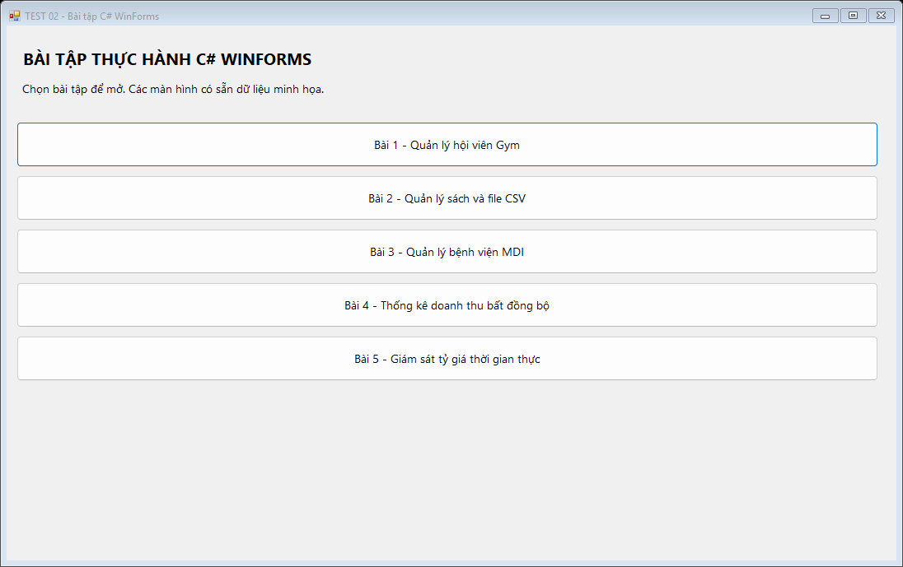
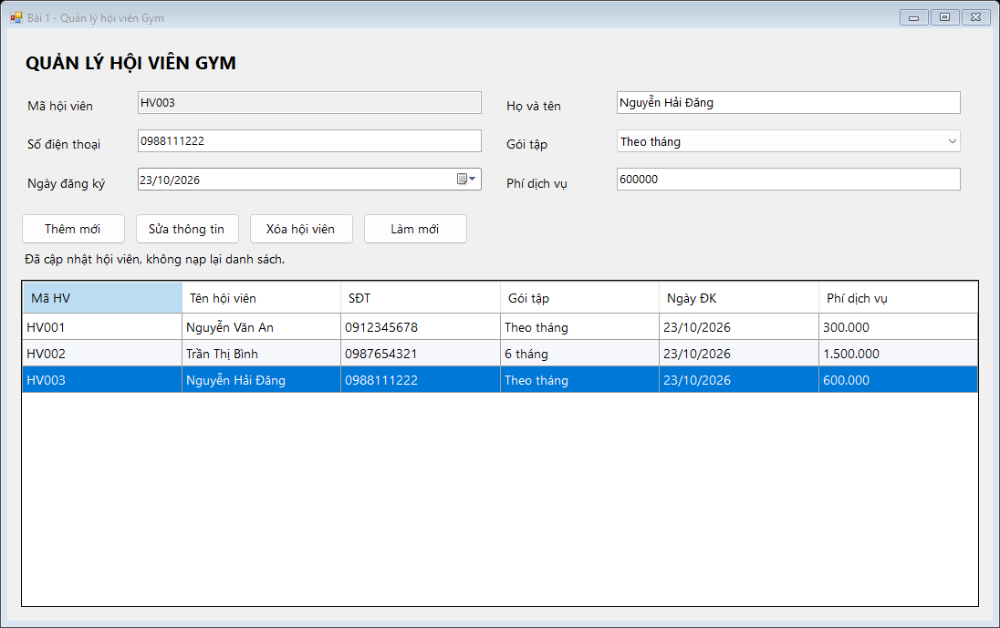
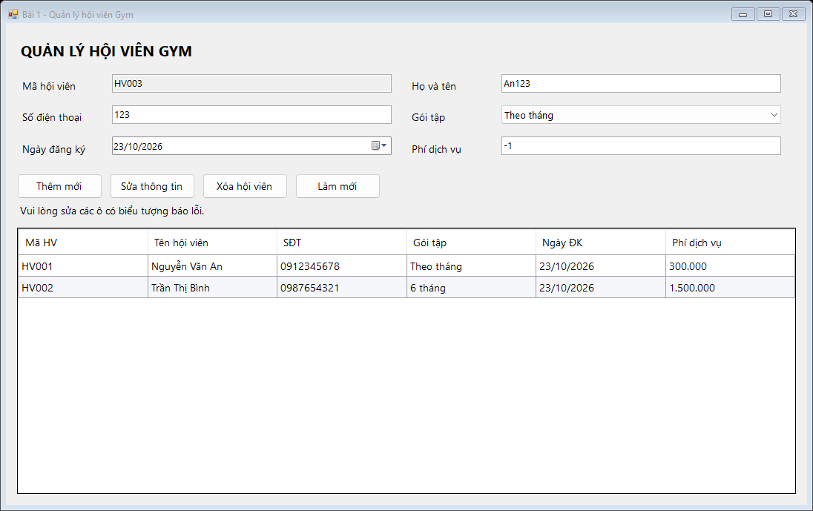
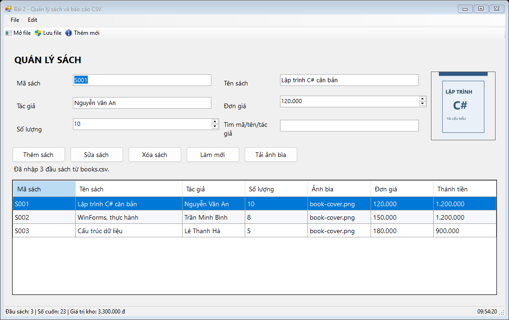
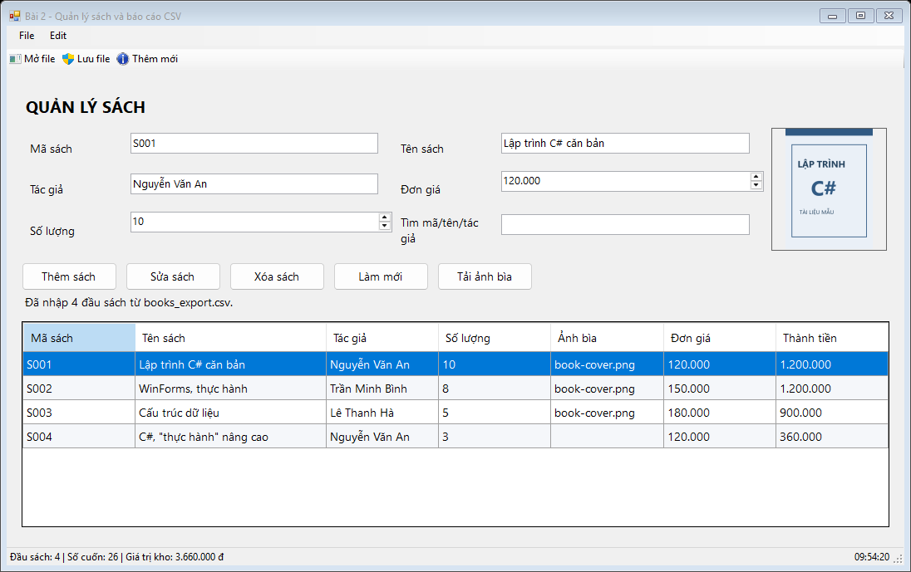
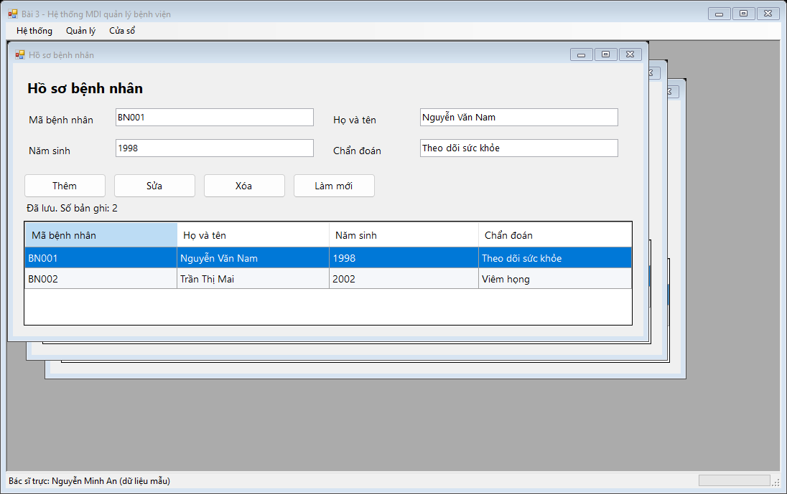
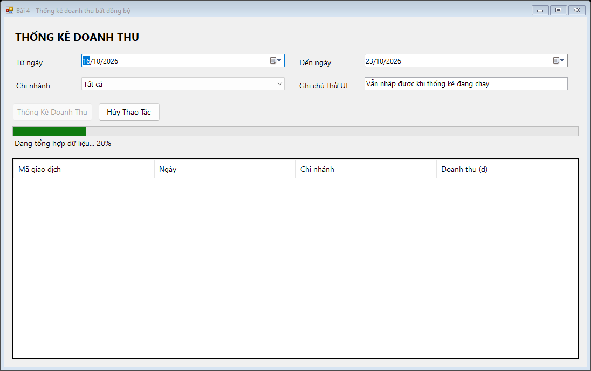
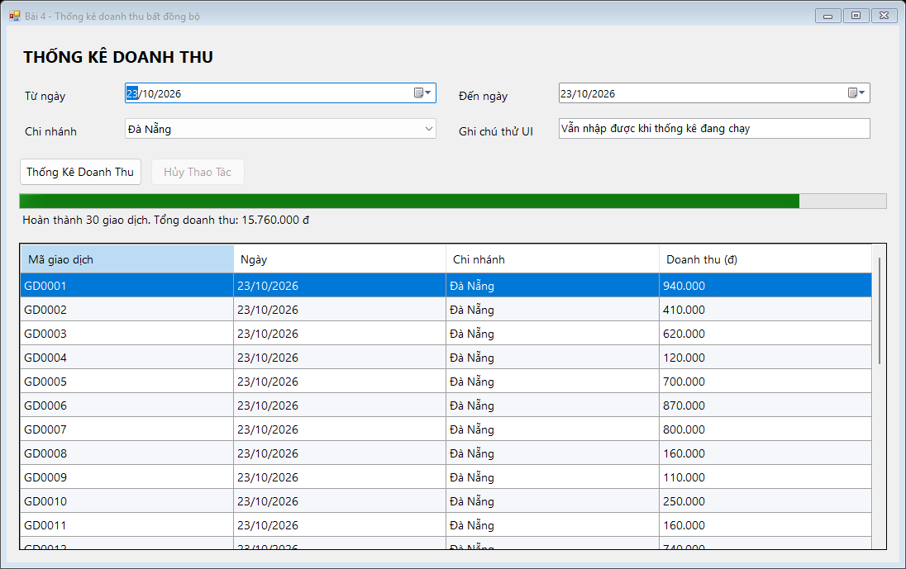
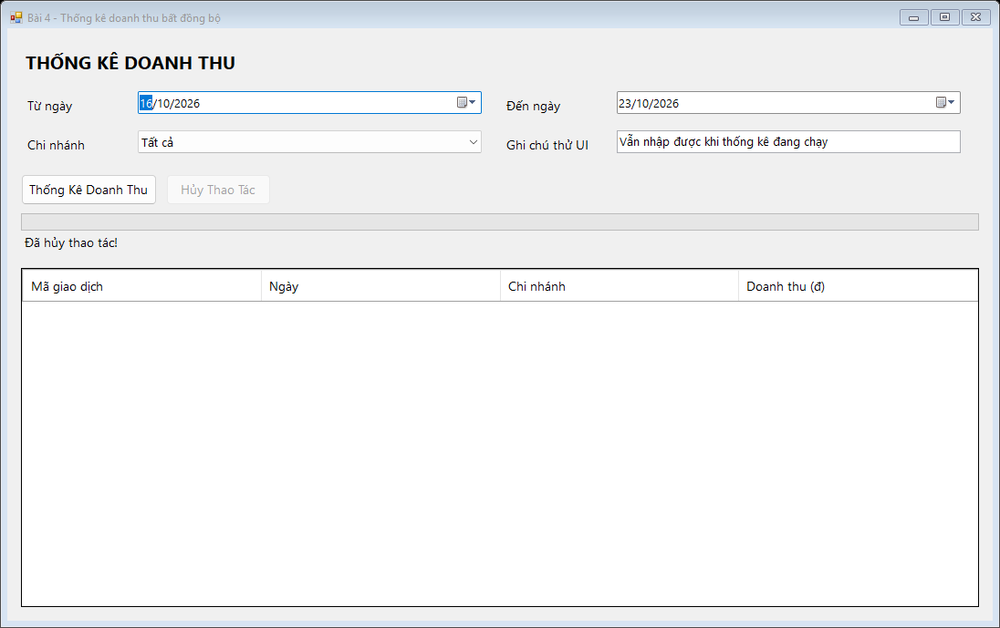
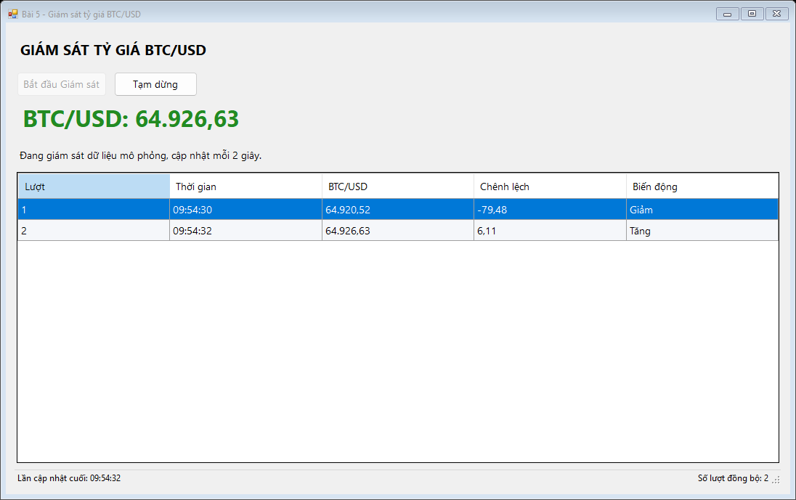

# BÁO CÁO BÀI TẬP THỰC HÀNH LẬP TRÌNH C# WINFORMS

## I. THÔNG TIN SINH VIÊN

- **Họ và tên:** Nguyễn Hải Đăng
- **Mã số sinh viên:** 24810320310
- **Lớp:** D19QTANM1
- **Môn:** Lập trình .NET - TEST 02
- **Link Repository:** https://github.com/NguyenHaiDang04/laptrinh.net
- **Thư mục bài làm trên GitHub:** [bài Plaintext](https://github.com/NguyenHaiDang04/laptrinh.net/tree/master/b%C3%A0i%20Plaintext)
- **Tên repository theo mẫu đề:** `LTNET-TEST02_24810320310_NguyenHaiDang`

Thông tin họ tên, MSSV được điền theo tên tài liệu có trong thư mục làm bài; lớp lấy từ tên đề PDF. Cần đối chiếu lại trước khi nộp. Thư mục cha được đặt là `bài Plaintext` theo yêu cầu làm bài.

## II. DANH SÁCH BÀI TẬP HOÀN THÀNH & TỰ ĐÁNH GIÁ

| Bài tập | Tiêu đề | Trạng thái triển khai | Mức độ hoàn thành chức năng |
| :---: | :--- | :---: | :---: |
| **1** | Quản lý Dịch vụ Phòng Gym & Hội viên | Hoàn thành | 100% |
| **2** | Quản lý Tài liệu Sách & Xuất báo cáo CSV | Hoàn thành | 100% |
| **3** | Hệ thống MDI Quản lý Bệnh viện | Hoàn thành | 100% |
| **4** | Thống kê doanh thu Async/Await & Cancellation | Hoàn thành | 100% |
| **5** | Giám sát tỷ giá & Cross-thread safety | Hoàn thành | 100% |

Các tỷ lệ trên là tự đánh giá phần chức năng đã triển khai, không phải điểm chấm của giảng viên. Kết quả kiểm tra tự động thực tế nằm trong [docs/verification.txt](docs/verification.txt).

## III. MINH HỌA GIAO DIỆN & KỸ THUẬT NỔI BẬT

### Màn hình chọn bài



Mỗi nút mở một bài tập. Đóng cửa sổ bài tập để quay lại màn hình chọn bài.

### 1. Quản lý Dịch vụ Phòng Gym & Hội viên

- Form: `frmGymMemberManager`; model: `MemberModel`.
- Tạo toàn bộ cột `DataGridView` bằng C#, đặt `AutoGenerateColumns = false`, `DataPropertyName`, `ReadOnly = true`, `SelectionMode = FullRowSelect`.
- Dùng `BindingList<MemberModel>` và `BindingSource`; model triển khai `INotifyPropertyChanged`.
- Chọn dòng để đưa thông tin lên control. Bấm **Sửa thông tin** để ghi các binding sau khi kiểm tra hợp lệ. Không nạp lại danh sách.
- `ErrorProvider`: họ tên chỉ gồm chữ/khoảng trắng, hỗ trợ tiếng Việt; điện thoại đúng 10 chữ số; phí là số nguyên dương. Phí trên lưới định dạng `N0`.
- Mã hội viên tự sinh `HV001`, `HV002`... và không tái sử dụng mã vừa xóa trong phiên chạy.
- **Làm mới** xóa nội dung nhập; **Thêm mới** lưu thông tin đang nhập thành hội viên mới.
- Xóa có `MessageBoxButtons.YesNo` và `MessageBoxIcon.Warning`.





### 2. Quản lý & Xuất Báo cáo Nhà sách

- Form: `frmBookManager`; model: `BookModel`; đọc/ghi file trong `BookCsvService`.
- Có MenuStrip **File/Edit**, ToolStrip với icon, StatusStrip hiển thị số đầu sách, tổng số cuốn, tổng giá trị kho và đồng hồ.
- Thêm/sửa/xóa sách, tìm theo mã/tên/tác giả. Tổng giá trị kho = tổng `(đơn giá × số lượng)` của toàn bộ danh sách, không phụ thuộc bộ lọc tìm kiếm.
- `OpenFileDialog` chọn PNG/JPG và mở CSV; `SaveFileDialog` xuất CSV.
- Ảnh được sao chép vào bộ nhớ rồi đóng file nguồn để tránh khóa file ảnh. Khi ảnh bị thiếu/hỏng, dữ liệu sách vẫn được giữ.
- CSV dùng UTF-8, hỗ trợ dấu phẩy và dấu ngoặc kép trong tên sách. Đường dẫn ảnh được xuất tương đối với vị trí CSV khi có thể.
- Import kiểm tra toàn bộ file trước khi thay dữ liệu; file sai định dạng hoặc mã trùng sẽ không làm mất danh sách hiện tại. Import có xác nhận thay danh sách.
- Lưu CSV xuất toàn bộ danh sách, kể cả khi đang tìm kiếm. Có sẵn `src/WinFormsApp/Data/books.csv` và ảnh mẫu.





File xuất minh họa: [docs/books_export.csv](docs/books_export.csv).

Định dạng CSV:

```csv
BookId,Title,Author,UnitPrice,Quantity,CoverPath
S001,Lập trình C# căn bản,Nguyễn Văn An,120000,10,Images/book-cover.png
```

Đơn giá trong file dùng dấu chấm nếu có phần thập phân, không có dấu phân cách hàng nghìn. Nếu chuyển CSV sang máy khác, cần chuyển các ảnh cùng cấu trúc đường dẫn. Giới hạn nhập: đơn giá từ 1 đến 1.000.000.000; số lượng từ 0 đến 1.000.000.

### 3. Kiến trúc MDI Quản lý Bệnh viện

- Form cha `frmHospitalMain`, `IsMdiContainer = true`.
- Form con: `frmPatientProfiles`, `frmDoctorSchedule`, `frmDepartments`.
- Các danh mục có thêm/sửa/xóa/làm mới; mã không trùng, ô thông tin không rỗng, năm sinh hợp lệ.
- Duyệt `MdiChildren`: nếu form đã mở thì khôi phục nếu đang thu nhỏ và gọi `Activate()`; nếu chưa có thì gán `MdiParent = this`, gọi `Show()`.
- Menu Cửa sổ: Cascade, Tile Horizontal, Tile Vertical, Đóng tất cả và danh sách cửa sổ đang mở.
- Menu Hệ thống: Đăng xuất, Nạp lại dữ liệu, Thoát. Đăng xuất/Thoát trở về màn hình chọn bài; nạp lại khôi phục dữ liệu mẫu sau xác nhận.
- StatusStrip có bác sĩ trực mẫu và `ToolStripProgressBar` khi nạp lại dữ liệu.



### 4. Thống kê doanh thu bất đồng bộ

- Form `frmRevenueAnalytics`: Từ ngày, Đến ngày, Chi nhánh, Thống Kê Doanh Thu, Hủy Thao Tác, ProgressBar, Label và DataGridView.
- Bắt buộc dùng `await Task.Run(...)`; giả lập tổng hợp 5 giây bằng 20 bước `Task.Delay(250, token)`.
- Dùng `IProgress<int>` cập nhật tiến độ về UI thread; người dùng vẫn nhập được ghi chú và di chuyển/phóng to/thu nhỏ cửa sổ.
- `CancellationTokenSource` hủy an toàn, dừng tiến độ và hiển thị đúng **Đã hủy thao tác!**.
- Chống chạy trùng; khôi phục trạng thái nút sau hoàn thành/hủy/lỗi; đóng form hủy tác vụ. Kiểm tra Từ ngày không lớn hơn Đến ngày.
- Kết quả gồm 30 giao dịch giả lập theo khoảng ngày và chi nhánh đã chọn. Khi hủy, giữ kết quả lần thống kê trước nếu có.







### 5. Giám sát tỷ giá thời gian thực

- Form `frmCryptoStockTicker`: Bắt đầu Giám sát, Tạm dừng, giá BTC/USD, nhật ký và StatusStrip.
- `Task.Run` chạy vòng lặp; cứ 2 giây sinh giá ngẫu nhiên mới. Đây là dữ liệu mô phỏng, không gọi API tài chính.
- Kiểm tra `InvokeRequired` và dùng `Invoke(new Action(...))` để đưa toàn bộ cập nhật Label, BindingList/DataGridView và StatusStrip về UI thread.
- Giá tăng màu xanh, giảm màu đỏ, không đổi màu xám; có giờ cập nhật `HH:mm:ss` và tổng lượt đồng bộ.
- Tạm dừng bằng cancellation; Bắt đầu lại tiếp tục từ giá trước đó, giữ lịch sử; chống chạy nhiều vòng lặp; đóng form dừng tác vụ.
- Bật `Control.CheckForIllegalCrossThreadCalls = true` để phát hiện truy cập control sai luồng khi chạy kiểm tra.



## IV. HƯỚNG DẪN CÀI ĐẶT & CHẠY DỰ ÁN

### Yêu cầu

- Windows.
- Visual Studio 2022 hoặc mới hơn, workload **.NET desktop development**.
- **.NET Framework 4.8 Developer Pack / Targeting Pack**.
- Không cần SQL Server hoặc thư viện NuGet bên ngoài.

### Chạy trong Visual Studio

1. Mở thư mục `bài Plaintext` có đủ `src` và `docs`.
2. Mở file `src/WinFormsAppSolution.sln`.
3. Nếu cần, đặt project `WinFormsApp` làm Startup Project.
4. Chọn cấu hình **Debug / Any CPU**, bấm **F5**.
5. Chọn bài tập ở màn hình chính.

Build bằng **Developer PowerShell for Visual Studio**, tại thư mục `bài Plaintext`:

```powershell
msbuild .\src\WinFormsAppSolution.sln /t:Build /p:Configuration=Debug
```

Sau build, chương trình nằm tại `src/WinFormsApp/bin/Debug/WinFormsApp.exe`.

### Kiểm tra tự động và tạo lại ảnh báo cáo

Sau khi build, tại thư mục `bài Plaintext`:

```powershell
$app = Join-Path $PWD 'src\WinFormsApp\bin\Debug\WinFormsApp.exe'
$docs = Join-Path $PWD 'docs'
Start-Process -FilePath $app -ArgumentList @('--verify', ('"' + $docs + '"')) -Wait
Get-Content .\docs\verification.txt
```

Chế độ này chạy các form thử nghiệm ngoài vùng màn hình, kiểm tra dữ liệu, CSV, vòng đời MDI, phản hồi UI, hủy và khởi động lại tác vụ; đồng thời lưu ảnh PNG từ chính form đang chạy. Dữ liệu kiểm tra độc lập với phiên làm việc thông thường.

Các thao tác cần tự kiểm tra thêm khi trình bày: chọn file trong OpenFileDialog/SaveFileDialog, bấm Yes/No ở hộp thoại xóa, kéo/phóng to/thu nhỏ cửa sổ khi thống kê, quan sát sắp xếp các cửa sổ MDI. Ảnh tĩnh không tự chứng minh được thao tác kéo cửa sổ.

### Cấu trúc thư mục

```text
bài Plaintext/
├── .gitignore
├── README.md
├── docs/
│   ├── main.png
│   ├── bai1_main.png
│   ├── bai1_error.png
│   ├── bai2_main.png
│   ├── bai2_csv.png
│   ├── bai3_mdi.png
│   ├── bai3_async.png
│   ├── bai4_async.png
│   ├── bai4_main.png
│   ├── bai4_cancel.png
│   ├── bai5_main.png
│   ├── books_export.csv
│   └── verification.txt
└── src/
    ├── WinFormsAppSolution.sln
    └── WinFormsApp/
        ├── WinFormsApp.csproj
        ├── Program.cs
        ├── Models/Models.cs
        ├── Forms/
        ├── Services/BookCsvService.cs
        ├── Verification/AppVerification.cs
        └── Data/
            ├── books.csv
            └── Images/book-cover.png
```

### Quy ước theo những chỗ chưa thống nhất trong đề

1. Đề có 5 bài nhưng mẫu README chỉ có 3 mục: báo cáo này tách đầy đủ 5 bài.
2. Bài 1 nhắc email/ngày hết hạn ở mục tiêu nhưng không có ô nhập và quy tắc cụ thể: triển khai đúng 6 trường giao diện và 3 quy tắc validation được liệt kê.
3. Đề viết `FullRowSelect = true`: dùng thuộc tính WinForms tương ứng `SelectionMode = DataGridViewSelectionMode.FullRowSelect`.
4. Bài 2 chọn CSV theo yêu cầu nghiệp vụ; bổ sung các trường đơn giá/số lượng để tính tổng kho.
5. Danh mục Bác sĩ và Lịch trực dùng chung `frmDoctorSchedule`; thêm `frmDepartments` để menu Khoa/Phòng hoạt động đầy đủ.
6. Đề không yêu cầu màn hình đăng nhập: Đăng xuất quay về màn hình chọn bài.
7. Dữ liệu Gym/Bệnh viện giữ trong bộ nhớ trong phiên mở bài; sách lưu bền bằng thao tác Lưu CSV. Không dùng cơ sở dữ liệu thật.
8. Ảnh `bai3_async.png` giữ theo mẫu báo cáo; phần phân tích Async nằm ở Bài 4.

### Nộp GitHub

Bài làm được lưu trong thư mục `bài Plaintext` của repository **Public** `NguyenHaiDang04/laptrinh.net` theo đường dẫn được chỉ định. Tên repository theo mẫu đề được ghi ở mục I để đối chiếu khi nộp. `.gitignore` đã loại `.vs/`, `bin/`, `obj/` và các file cá nhân. Không đưa các thư mục này lên Git; đề quy định có thể trừ 10–20% tổng điểm nếu nộp kèm thư mục rác.
